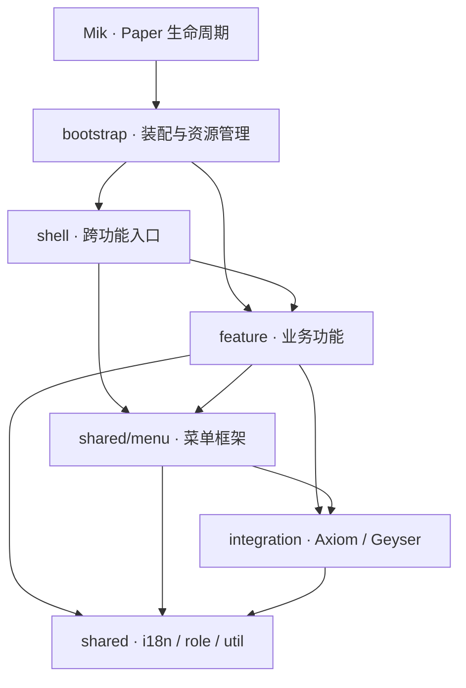

# 项目功能架构

代码按职责层、业务领域、具体功能组织。功能维护自己的规则和数据，`bootstrap` 负责创建对象并连接跨功能能力。

## 职责层

以下路径相对于 `src/main/java/org/encinet/mik/`。

| 位置 | 负责 | 使用边界 |
| --- | --- | --- |
| `Mik.java` | Paper 生命周期与 Plasmo Voice 注入 | 只调用 `MikRuntime` |
| `MikLoader.java` | 为插件类加载器声明运行时库 | 不创建业务功能 |
| `bootstrap/` | 创建功能、传入能力、注册命令、管理启停 | 可引用功能装配类；业务功能不引用此层 |
| `feature/<领域>/<功能>/` | 功能规则、状态、存储、事件、命令和页面 | 通过能力接口、数据类型或回调调用其他功能 |
| `shared/` | 多功能共用的语言、菜单、角色定义与工具 | 不依赖业务功能或跨功能入口 |
| `integration/` | 多功能共用的外部插件协议与 API 适配 | 不依赖业务功能；可使用共享服务 |
| `shell/` | 聚合多个功能的菜单、网页和脚本入口 | 调用功能提供的能力，不接管功能状态 |

`shared/menu` 会使用 Axiom 与 Geyser 的呈现适配；Geyser 适配使用共享语言服务。依赖检查按具体能力包进行，避免把整个 `shared` 与 `integration` 误当作两个互相依赖的业务功能。

## 功能地图

### 玩家：`feature/player/`

| 功能包 | 职责 |
| --- | --- |
| `address/` | 玩家地址记录、最近访问查询、关联账号通知 |
| `afk/` | 自动与手动 AFK、活跃证据、抑制租约、观看状态 |
| `client/` | 客户端版本与模组查询能力；`detection/` 管理检测，`tip/` 读取结果生成建议 |
| `guidance/` | 声明式场景提示、类型化事件订阅、有界调度、展示档位和自适应匹配密度；业务条件由各功能维护 |
| `mode/` | 游戏模式切换所需的客户端权限状态同步 |
| `movement/` | 飞行、速度和世界边界约束 |
| `presence/` | 欢迎、加入与退出通知、隐身状态通知 |
| `profile/` | 玩家身份组件、称号、名牌与 Tab 展示；名称标签的日常提示 |
| `pvp/` | 玩家战斗偏好、覆盖规则、战斗判定及受保护攻击的场景提示 |
| `effects/` | 创造与旁观模式的负面效果提醒、来源展示与一次性清除请求；装配层注入实际 PVP 战斗查询 |
| `teleport/` | 家、返回、传送偏好与同意请求、管理员强制传送；自有操作与聊天场景提示 |
| `trash/` | 私人垃圾箱命令、原生大箱子菜单、整理、清空与关闭后的延时清理 |
| `utility/` | 主城、帽子、掉落物清理、自助退出等日常命令；主城、帽子与掉落物清理的聊天及日常随机提示 |

`profile` 表示游戏内姓名与外观展示；外部账号绑定属于社区的 `identity`。AFK 的 DreamDisplays 适配位于 `afk/viewing/integration/dreamdisplays/`，跟随观看规则和测试维护。

`/tpforce` 复用原版 `/tp` 的参数与补全，忽略玩家的传送偏好及挂机限制，例如 `/tpforce 玩家 目标玩家`、`/tpforce 玩家 100 64 100`。命令仅允许拥有 `group.moderator` 或 `group.custodian` 权限的管理员与服主使用；普通 `/tp` 继续检查玩家偏好。

客户端检测通过 `ClientVersions`、`ClientMods` 暴露只读快照。检测实现维护协议和连接信号；客户端提示、主菜单及 Skript 通过接口查询。推荐清单与文案由 `client/tip/` 维护，检测层不依赖提示或语言服务。

### 社区：`feature/community/`

| 功能包 | 职责 |
| --- | --- |
| `ai/` | AI 请求、会话、知识库、工具和提供商实现 |
| `chat/` | 游戏聊天模型、处理流程、富文本、私聊场景规则与外部聊天桥接契约 |
| `communication/` | 公告与阅读状态 |
| `governance/` | 社区成员资格、投票、罢免和结果交付 |
| `identity/` | 游戏账号与外部身份绑定、平台注册和绑定存储 |
| `social/` | 共享社交命令、运行时、QQ 与 Matrix 协议适配 |

Social 通过 `AiGateway` 调用 AI，通过身份管理能力查询绑定，通过聊天桥接契约进入游戏聊天。QQ、Matrix 的协议代码仍留在 `social/platform`，以便与共享命令、会话和输出策略区分。

### 世界：`feature/world/`

| 功能包 | 职责 |
| --- | --- |
| `plot/` | 地段与子地段、区域编辑、权限、公示板和预览 |
| `regen/` | 世界更新计划、区块捕获、预览、异步计算与应用 |
| `space/` | 非欧几里得空间、表面、连接、穿越与索引 |
| `elevator/` | 铁电梯发现、楼层、调度、移动和面板 |
| `vehicle/` | 载具定义、模型编辑、物理、驾驶与仪表盘 |
| `spawn/` | 出生点信标颜色设置 |

载具专用的 Axiom 事件保护位于 `vehicle/integration/axiom/`；多个功能共同使用的 Axiom Gizmo 服务位于全局 `integration/axiom/`。地段的社交通知由装配层传入 `PlotNoticePublisher` 回调，地段不依赖 Social 实现。

### 娱乐：`feature/entertainment/`

| 功能包 | 职责 |
| --- | --- |
| `music/` | 本地与在线曲库、唱片、播放、歌词、节奏游戏和界面 |
| `event/` | 周年活动及抽奖规则 |

音乐继续在自己的功能包内区分 `catalog`、`disc`、`jukebox`、`rhythm`、`ui` 等职责。节奏算法、校准和播放资源不迁入通用工具目录。娱乐功能通过 AFK 活跃能力协调玩家状态。

### 服务器管理：`feature/server/`

| 功能包 | 职责 |
| --- | --- |
| `access/` | 维护模式、白名单和使用限制 |
| `ban/` | 封禁规则、记录、准入检查和 Paper 封禁同步 |
| `performance/` | 性能管理、网络出口监测、TPS 展示及性能信息栏的场景提示 |
| `presentation/` | 服务器品牌、MOTD、服务器列表和链接 |
| `safety/` | 物品与书页限值、实体大小、末影珍珠、踩踏和异常保护 |

社区治理可以调用封禁能力交付结果，但封禁功能不依赖治理。物品事件拦截和网络包处理共用同一套限值规则，各自处理所属协议或事件格式。

## 共享能力与入口

| 位置 | 所有权 |
| --- | --- |
| `shared/i18n/` | 消息键、语言选择、语言变更通知；译文在 `src/main/resources/lang/` |
| `shared/menu/` | 菜单定义、布局、会话、导航、虚拟实体与世界文本呈现 |
| `shared/role/` | 玩家角色和权限组名称 |
| `shared/util/` | 调度、协议、地理查询、显示工具和独立清理步骤 |
| `integration/axiom/` | 跨功能使用的 Gizmo 服务与作用域 |
| `integration/geyser/` | 可选基岩版能力、表单协议与平台标记 |
| `shell/menu/` | 主菜单、语言菜单与入口布局 |
| `shell/api/` | 回环 HTTP 服务、网页登录验证码、玩家快照与只读数据聚合 |
| `shell/skript/` | 将现有功能能力暴露为 Skript 表达式与效果 |

功能自己的命令和菜单保留在功能内部。例如载具命令在 `feature/world/vehicle`，公告页面在 `feature/community/communication`；只有聚合多个功能的入口进入 `shell`。平台适配也遵循同一规则：某个功能独占的适配留在该功能内。

## 装配与生命周期

`bootstrap` 中的装配组按实际依赖顺序启用：

1. `MikRuntime` 启用品牌监听并写入异常退出标记。
2. `SharedServices` 创建 Axiom、Geyser、语言服务与菜单运行时。
3. `PlayerFeatures` 创建玩家状态、地址、身份展示和个人功能；独立创建客户端检测能力，再启用场景提示服务并注入检测查询，为客户端、家园等场景托管提示作用域。
4. `ServerFeatures` 创建封禁、准入、安全、性能和服务器展示；发现旧标记时恢复维护模式。
5. `CommunityFeatures` 创建 AI、绑定、聊天、Social、治理与公告。
6. `WorldFeatures` 创建世界功能，连接地段的社交通知，并为铁块电梯注入场景提示作用域。
7. `EntertainmentFeatures` 创建活动和音乐，接入语音与 AFK 能力。
8. `EntryPoints` 连接主菜单、语言菜单、可选 Skript 和网页 API。

这些装配组为包内类型，返回的记录只用于装配阶段传递已创建的对象。功能运行期间不查询装配组，也没有按类型或字符串查找服务的全局容器。

`ModuleLifecycle` 登记成功启动模块的关闭动作，也通过 `own` 托管构造前分配的独立资源，例如提示作用域。若某个模块启动失败，先调用该模块的关闭动作，再由 `MikRuntime` 逆序关闭此前已启动的模块与资源并取消插件任务。独立关闭步骤继续执行，错误附加到启动异常，便于定位原始失败与清理失败。

正常停服同样逆序关闭，然后卸载 Plasmo Voice 扩展。只有启动完整、全部关闭成功且语音扩展卸载成功时，`MaintenanceCrashMarker` 才删除标记。各功能内部的多个关闭步骤可使用 `ShutdownSequence`，执行完其余步骤后报告失败。

聊天与 Social 的双向运行连接由装配层显式完成：先创建 Social，取得聊天发布能力；创建 Chat 并绑定游戏接收端；启用 Chat 后再启用 Social。源码依赖通过聊天桥接接口保持单向。

## 数据与线程边界

- 每个功能独占自己的存储和迁移规则；其他功能通过能力查询或发起操作，不直接打开对方的数据库和状态文件。
- 提示服务独占展示间隔和自适应匹配记录，持久化复用玩家 PDC，只缓存在线玩家。接入模块只声明提示、查询既有业务状态或报告操作成功；普通自动提示在构造时注册，持久化与作用域清理由提示服务和装配层承担。
- 菜单页面由创建它的功能持有，按钮通过传入的 `FloatingMenuHandle` 操作当前页面。全局当前菜单查询用于核对回调是否仍对应前台页面。
- API 聚合公告、封禁和地段公示的只读能力；数据所有者仍是各业务功能。网页验证码的有效期和一次性消费由 API 维护。
- HTTP 在线程池中处理，Bukkit 玩家查询回到服务器主线程；网络监听线程只记录可并发访问的客户端信号，提醒在主线程发送。
- `LocalApiServer` 独占 HTTP 监听器和线程池。API 状态文件损坏或端口占用时记录错误并保持停用，其余功能继续启动，`/mikapi status` 可检查监听状态。
- 玩家峰值快照和公告已读位置严格加载并保存。损坏的文件不会在停用时被默认空数据覆盖。

## 增加功能时如何选择位置

先确定数据和规则由谁维护。新能力扩展现有功能时，放回该功能；只有独立的规则、状态或生命周期才新增 `feature/<领域>/<功能>`。功能内部再按实际职责拆分，例如规则、存储、协议和页面，不要求每个小功能都创建同样的空目录。

多功能共用且不依赖业务状态的机制进入 `shared`。跨功能共享的外部插件适配进入 `integration`。只服务一个功能的适配、算法或持久化类型保留在所属功能。跨功能导航和外部入口进入 `shell`，对象创建和能力连接进入 `bootstrap`。

跨功能依赖应引用所需的能力接口、数据或回调，避免导入对方的 `*Module`。`bootstrap` 和 `shell` 可以访问装配入口；功能、共享服务和通用适配不能反向引用它们。

## 测试约定

测试位于 `src/test/java/`，与生产包路径对应。运行命令和报告位置见[构建与验证](../README.md#构建与验证)。

- 行为测试通过真实方法、命令解析器或存储接口检查权限、边界输入、失败处理和持久化；测试输入应能实际触发被验证的问题。
- 架构测试检查目录与包名、功能归属、依赖方向、公开能力边界和依赖无环，避免锁定局部变量名、内部文件清单或源码片段。
- 通用语言资源由 `LanguageResourcesTest` 统一验证；功能测试补充特有的参数和展示行为。翻译调用与资源顺序由 `tools/i18n/audit.py` 检查。
- 性能测量使用 `@Tag("benchmark")`，通过 `./gradlew benchmark` 单独运行。缓存复用等可确定的行为仍由默认测试验证。
