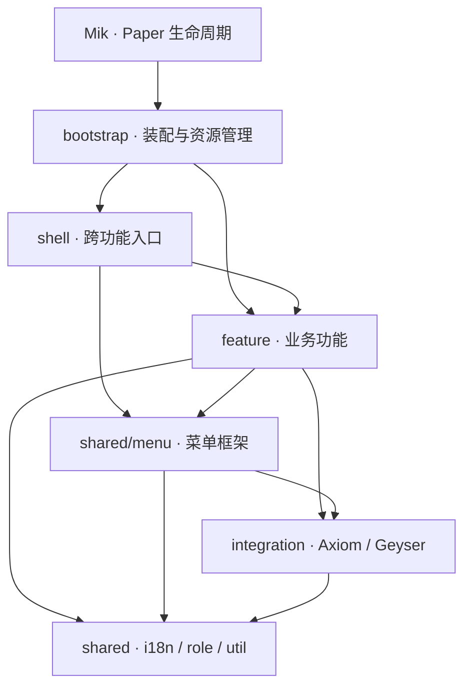

# 项目功能架构

代码按职责层、业务领域、具体功能组织。功能维护自己的规则和数据，`bootstrap` 负责创建对象并连接跨功能能力。

## 职责层

以下路径相对于 `src/main/java/org/encinet/mik/`。

| 位置 | 负责 | 使用边界 |
| --- | --- | --- |
| `Mik.java` | Paper 生命周期与 Plasmo Voice 注入 | 只调用 `MikRuntime` |
| `MikLoader.java` | 为插件类加载器声明运行时库 | 不创建业务功能 |
| `bootstrap/` | 创建功能、传入能力、注册命令、管理启停 | 可引用功能装配类；业务功能不引用此层 |
| `feature/<领域>/<功能>/` | 功能规则、状态、存储、事件、命令和页面 | 通过能力接口、数据类型或回调调用其他功能 |
| `shared/` | 多功能共用的语言、菜单、角色定义与工具 | 不依赖业务功能或跨功能入口 |
| `integration/` | 多功能共用的外部插件协议与 API 适配 | 不依赖业务功能；可使用共享服务 |
| `shell/` | 聚合多个功能的菜单、网页和脚本入口 | 调用功能提供的能力，不接管功能状态 |

`shared/menu` 通过 `integration/axiom` 呈现；`integration/geyser` 提供基岩玩家识别。依赖检查以具体能力包为单位。

## 功能地图

### 玩家：`feature/player/`

| 功能包 | 职责 |
| --- | --- |
| `address/` | 玩家地址记录、最近访问查询、关联账号通知 |
| `afk/` | 自动与手动 AFK、活跃证据、抑制租约、观看状态 |
| `client/` | 客户端版本与模组查询能力；`detection/` 管理检测，`tip/` 读取结果生成建议 |
| `guidance/` | 场景提示声明、事件订阅、调度与展示策略；见[场景提示](guidance.md) |
| `mode/` | 游戏模式切换所需的客户端权限状态同步 |
| `movement/` | 飞行、速度和世界边界约束 |
| `presence/` | 欢迎、加入与退出通知、隐身状态通知 |
| `security/` | 密码凭据、登录验证、重置授权与审计；见[账号安全](account-security.md) |
| `profile/` | 玩家身份组件、名牌与 Tab 展示；`nametag/` 维护[自定义名牌](name-tags.md) |
| `pvp/` | 玩家战斗偏好、覆盖规则、战斗判定及受保护攻击的场景提示 |
| `effects/` | 非战斗中创造与旁观玩家的负面效果提醒和清除 |
| `teleport/` | 家、返回、传送偏好与同意请求、管理员强制传送；自有操作与聊天场景提示 |
| `trash/` | 私人垃圾箱命令、原生大箱子菜单、整理、清空与关闭后的延时清理 |
| `utility/` | 主城、帽子、掉落物清理、自助退出等日常命令与提示 |

游戏姓名与外观由 `profile` 维护，外部账号绑定归社区 `identity`。客户端检测通过 `ClientVersions`、`ClientMods` 暴露只读快照，提示、菜单和 Skript 消费这些接口，见[客户端检测](client-reminders.md)。DreamDisplays 适配随 AFK 功能维护，见[观影会话](afk.md#dreamdisplays-实体屏幕观影)。

`/tpforce` 复用原版 `/tp` 的参数与补全，供 `group.moderator`、`group.custodian` 忽略传送偏好和挂机限制。普通 `/tp`、`/teleport` 与 `/tpforce` 均拒绝裸写的 `@e`；带条件的 `@e[...]` 及其他选择器遵循原权限。代理在功能内使用独立原版解析器，公开命令注册普通参数节点。

### 社区：`feature/community/`

| 功能包 | 职责 |
| --- | --- |
| `ai/` | AI 请求、会话、知识库、工具和提供商实现 |
| `chat/` | 消息模型、频道、富文本与投递；`bridge/` 提供外部能力，`history/` 维护存储，`web/` 维护网页会话和协议；见[网页聊天](web-chat.md) |
| `communication/` | [公告](announcements.md)与阅读状态，通过 `AnnouncementPublisher` 发布更新 |
| `governance/` | 社区成员资格、管理目录、投票、任免与结果交付；见[社区治理](governance.md) |
| `identity/` | 游戏账号与外部身份绑定、平台成员核验、登录准入、平台注册和绑定存储 |
| `social/` | 共享社交命令、运行时、QQ 与 Matrix 协议适配 |

Social 通过 `AiGateway` 调用 AI，通过 Identity 查询绑定，通过聊天桥提交和发布消息。共享命令维护定义、执行结果与回复；QQ、Matrix 的协议、成员事实及加密资源归各自 `social/platform/` 适配器，见[社交平台架构](social-platforms.md)、[QQ](qq-bot.md)和 [Matrix](matrix-bot.md)。

Identity 独占绑定数据库与查询快照，用完整外部身份键去重、`binding_id` 标识一次绑定关系。平台通过 `IdentityMemberships` 提供成员证据；`IdentityMembershipCoordinator` 汇总证据，`IdentityAdmission` 在登录配置阶段核验准入。具体身份范围、解绑事务与故障处理见[身份绑定](identity-binding.md)。

### 世界：`feature/world/`

| 功能包 | 职责 |
| --- | --- |
| `buildings/` | 公开建筑目录的校验与缓存、Pl3xMap 原生兴趣点、双语信息卡；独占可选地图 API 适配 |
| `plot/` | 地段与子地段、传送点、区域编辑、权限、公告板和预览 |
| `regen/` | 世界更新计划、区块捕获、预览、异步计算与应用 |
| `space/` | 非欧几里得空间、表面、连接、穿越与索引 |
| `elevator/` | 物理平台与楼层、共享目录发现、玩家访问与群组移动、固定面板安放及呈现 |
| `vehicle/` | 载具定义、模型编辑、物理、驾驶与仪表盘 |
| `spawn/` | 出生点信标颜色设置 |

世界功能维护自己的编辑草稿、预览和运行资源，操作提交时复核目标与权限。具体结构见[铁电梯](iron-elevator.md)、[载具](vehicles.md)、[地段工作区](plot-board.md)与[选区编辑](plot-subplots.md)。载具专用 Axiom 适配位于 `vehicle/integration/axiom/`，共用的 Gizmo 和图片注解适配位于全局 `integration/axiom/`。

### 娱乐：`feature/entertainment/`

| 功能包 | 职责 |
| --- | --- |
| `music/` | 本地与在线曲库、唱片、播放、歌词、节奏游戏和界面 |
| `event/` | 周年活动及抽奖规则 |

音乐的模型、应用、设备、存储、音游与界面分工见[音乐架构](music-architecture.md)。娱乐功能通过 AFK 活跃能力上报玩法输入。

### 服务器管理：`feature/server/`

| 功能包 | 职责 |
| --- | --- |
| `access/` | 维护模式和使用限制；绑定准入由社区 Identity 管理 |
| `auth/` | 正版认证容灾、已验证身份与来源地址缓存、Paper 认证服务接入与恢复；见[认证容灾](authentication-fallback.md) |
| `ban/` | 封禁规则、记录、准入检查和 Paper 封禁同步 |
| `monitor/` | 管理员随机轮换旁观、附近跟随、退出恢复与隐身通知排除能力；见[管理员监控](server-monitor.md) |
| `performance/` | 性能信息、网络反馈限流与跑图保护；见[网络出口](network-egress.md) |
| `presentation/` | 服务器品牌、MOTD、服务器列表和链接 |
| `safety/` | 物品与书页限值、实体大小、末影珍珠、踩踏、液体、爆炸、危险实体和异常保护；见[世界安全保护](server-safety.md) |

社区治理可以调用封禁能力交付结果，但封禁功能不依赖治理。物品事件拦截和网络包处理共用同一套限值规则，各自处理所属协议或事件格式。

## 共享能力与入口

| 位置 | 所有权 |
| --- | --- |
| `shared/i18n/` | 消息键、语言选择、语言变更通知；译文在 `src/main/resources/lang/` |
| `shared/menu/` | 场景与导航、组件布局、图片、输入和显示资源；见[菜单架构](spatial-menu-design.md) |
| `shared/role/` | 玩家角色和权限组名称 |
| `shared/util/` | 调度、协议、地理查询、玩家姓名缓存解析、显示工具和独立清理步骤 |
| `integration/axiom/` | 共用 Gizmo、临时图片注解协议、差量同步和资源作用域 |
| `integration/geyser/` | 可选 Geyser 接入与基岩玩家识别 |
| `shell/menu/` | 主菜单、语言菜单和分类设置宿主，嵌入功能提供的 `MenuPanel` |
| `shell/api/` | 回环 HTTP 服务、网页登录验证码、玩家快照与只读数据聚合 |
| `shell/skript/` | 将现有功能能力暴露为 Skript 表达式与效果 |

## 装配与生命周期

`bootstrap` 中的装配组按实际依赖顺序启用：

1. `MikRuntime` 启用品牌监听并写入异常退出标记。
2. `SharedServices` 创建 Axiom、Geyser、语言服务与菜单运行时。
3. `PlayerFeatures` 首先启用账号密码准入，再创建玩家状态、地址、身份展示和个人功能；独立创建客户端检测能力，再启用场景提示服务并注入检测查询，为客户端、家园等场景托管提示作用域。
4. `ServerFeatures` 接入正版认证容灾，创建封禁、监控、准入、安全、性能和服务器展示；将监控会话查询注入隐身通知，发现旧标记时恢复维护模式。
5. `CommunityFeatures` 创建 AI、绑定、聊天、Social、治理与公告。
6. `WorldFeatures` 创建世界功能，为铁块电梯注入固定面板和场景提示作用域。
7. `EntertainmentFeatures` 创建活动和音乐，接入语音、AFK 与只读地段授权能力。
8. `EntryPoints` 连接主菜单、语言菜单、可选 Skript 和网页 API。

装配组为包内类型，通过返回记录传递已创建对象；功能运行时使用注入的能力。

`ModuleLifecycle` 登记成功启动模块的关闭动作，也通过 `own` 托管构造前分配的独立资源，例如提示作用域。若某个模块启动失败，先调用该模块的关闭动作，再由 `MikRuntime` 逆序关闭此前已启动的模块与资源并取消插件任务。独立关闭步骤继续执行，错误附加到启动异常，便于定位原始失败与清理失败。

正常停服同样逆序关闭，然后卸载 Plasmo Voice 扩展。只有启动完整、全部关闭成功且语音扩展卸载成功时，`MaintenanceCrashMarker` 才删除标记。各功能内部的多个关闭步骤可使用 `ShutdownSequence`，执行完其余步骤后报告失败。

### 聊天装配

先创建 Social 并取得发布能力，再创建 Chat、连接双向桥，依次启用 Chat 和 Social。源码依赖由 `chat/bridge` 的能力接口隔离。

`ChatModule` 拥有生命周期，`game/` 处理 Paper 事件、命令与延迟发送，`runtime/ChatService` 处理各来源消息并投递。`ChatAudience` 维护频道成员规则，`ChatSendLedger` 维护游戏与网页共用的发言额度；`ChatHistoryStore` 在事务中维护网页请求去重和持久化顺序。来源入口负责鉴权和输入校验。

`ChatSubmission` 组合来源、作者和会话，`ChatContent`、`ChatStyle` 保存语义正文；各端分别渲染。Paper 原生消息在正文与接收范围最终确定后提交跨端输出，受限范围随投递保存。各输出独立报告失败。服务端事件通过 `ServerChatPublisher` 使用同一投递流程。

包依赖由入口与适配层指向能力和模型，`ChatPackageArchitectureTest` 检查方向与循环。历史存储、压缩和线程分工见[网页聊天](web-chat.md#线程与队列)。

## 数据与线程边界

- 功能独占存储，通过能力提供查询和操作；调用方不直接读写其数据库或状态文件。
- Bukkit 状态在主线程读写，HTTP、文件和耗时计算在后台执行，跨线程传递不可变快照。异步结果提交时复核会话、目标与权限。
- 任务、线程、连接和临时显示随所属功能关闭。提示作用域及显示资源的通用清理由共享服务负责。
- 菜单页面归创建它的功能，通过 `FloatingMenuHandle` 操作当前会话；全局菜单查询用于核对回调目标。
- `LocalApiServer` 独占回环 HTTP 监听器与线程池。状态损坏或端口占用时保持 API 停用，通过 `/mikapi status` 检查。
- 网页公共 WebSocket 与私有账号 API 分端口，授权与撤销只经私有 API。API 聚合业务只读能力，网页登录的一次性消费和会话创建由 MikData 事务完成。
- 持久状态加载失败时报告错误并保留原文件。

## 增加功能时如何选择位置

先确定数据和规则由谁维护。新能力扩展现有功能时，放回该功能；只有独立的规则、状态或生命周期才新增 `feature/<领域>/<功能>`。功能内部再按实际职责拆分，例如规则、存储、协议和页面，不要求每个小功能都创建同样的空目录。

多功能共用且不依赖业务状态的机制进入 `shared`。跨功能共享的外部插件适配进入 `integration`。只服务一个功能的适配、算法或持久化类型保留在所属功能。跨功能导航和外部入口进入 `shell`，对象创建和能力连接进入 `bootstrap`。

跨功能依赖应引用所需的能力接口、数据或回调，避免导入对方的 `*Module`。`bootstrap` 和 `shell` 可以访问装配入口；功能、共享服务和通用适配不能反向引用它们。

## 测试约定

测试位于 `src/test/java/`，与生产包路径对应。运行命令和报告位置见[构建与验证](../README.md#构建与验证)。

- 行为测试通过真实方法、命令解析器或存储接口检查权限、边界输入、失败处理和持久化；测试输入应能实际触发被验证的问题。
- 架构测试检查目录与包名、功能归属、依赖方向、公开能力边界和依赖无环，避免锁定局部变量名、内部文件清单或源码片段。
- 通用语言资源由 `LanguageResourcesTest` 统一验证；功能测试补充特有的参数和展示行为。翻译调用与资源顺序由 `tools/i18n/audit.py` 检查。
- 性能测量使用 `@Tag("benchmark")`，通过 `./gradlew benchmark` 单独运行。缓存复用等可确定的行为仍由默认测试验证。
