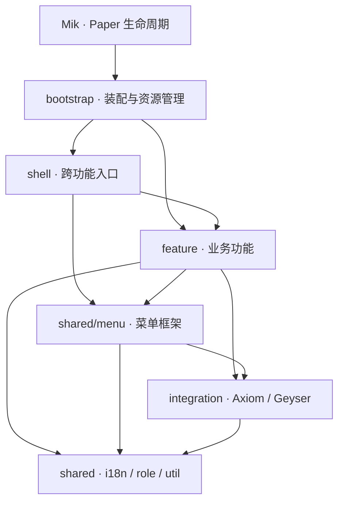

# 项目功能架构

代码按职责层、业务领域、具体功能组织。功能维护自己的规则和数据，`bootstrap` 负责创建对象并连接跨功能能力。

## 职责层

以下路径相对于 `src/main/java/org/encinet/mik/`。

| 位置 | 负责 | 使用边界 |
| --- | --- | --- |
| `Mik.java` | Paper 生命周期与 Plasmo Voice 注入 | 只调用 `MikRuntime` |
| `MikLoader.java` | 为插件类加载器声明运行时库 | 不创建业务功能 |
| `bootstrap/` | 创建功能、传入能力、注册命令、管理启停 | 可引用功能装配类；业务功能不引用此层 |
| `feature/<领域>/<功能>/` | 功能规则、状态、存储、事件、命令和页面 | 通过能力接口、数据类型或回调调用其他功能 |
| `shared/` | 多功能共用的语言、菜单、角色定义与工具 | 不依赖业务功能或跨功能入口 |
| `integration/` | 多功能共用的外部插件协议与 API 适配 | 不依赖业务功能；可使用共享服务 |
| `shell/` | 聚合多个功能的菜单、网页和脚本入口 | 调用功能提供的能力，不接管功能状态 |

`shared/menu` 使用 Axiom 的呈现适配；Geyser 集成只提供其他功能需要的玩家识别，不参与菜单呈现。依赖检查按具体能力包进行，避免把整个 `shared` 与 `integration` 误当作两个互相依赖的业务功能。

## 功能地图

### 玩家：`feature/player/`

| 功能包 | 职责 |
| --- | --- |
| `address/` | 玩家地址记录、最近访问查询、关联账号通知 |
| `afk/` | 自动与手动 AFK、活跃证据、抑制租约、观看状态 |
| `client/` | 客户端版本与模组查询能力；`detection/` 管理检测，`tip/` 读取结果生成建议 |
| `guidance/` | 声明式场景提示、类型化事件订阅、有界调度、展示档位和自适应匹配密度；业务条件由各功能维护 |
| `mode/` | 游戏模式切换所需的客户端权限状态同步 |
| `movement/` | 飞行、速度和世界边界约束 |
| `presence/` | 欢迎、加入与退出通知、隐身状态通知 |
| `security/` | Argon2id 凭据、连接配置阶段验证、账号安全菜单、重置授权和审计；通过能力与治理协调密码保留要求 |
| `profile/` | 玩家身份组件、名牌与 Tab 展示；`nametag/` 拥有自定义节点、聊天编辑与预览、全服样式目录和复制 |
| `pvp/` | 玩家战斗偏好、覆盖规则、战斗判定及受保护攻击的场景提示 |
| `effects/` | 创造与旁观模式的负面效果提醒、来源展示与一次性清除请求；装配层注入实际 PVP 战斗查询 |
| `teleport/` | 家、返回、传送偏好与同意请求、管理员强制传送；自有操作与聊天场景提示 |
| `trash/` | 私人垃圾箱命令、原生大箱子菜单、整理、清空与关闭后的延时清理 |
| `utility/` | 主城、帽子、掉落物清理、自助退出等日常命令；主城、帽子与掉落物清理的聊天及日常随机提示 |

`profile` 表示游戏内姓名与外观展示；外部账号绑定属于社区的 `identity`。AFK 的 DreamDisplays 适配位于 `afk/viewing/integration/dreamdisplays/`，跟随观看规则和测试维护。

`/tpforce` 复用原版 `/tp` 的参数与补全，忽略玩家的传送偏好及挂机限制，例如 `/tpforce 玩家 目标玩家`、`/tpforce 玩家 100 64 100`。命令仅允许拥有 `group.moderator` 或 `group.custodian` 权限的管理员与服主使用；普通 `/tp` 继续检查玩家偏好。

为防止误传，玩家执行普通 `/tp`、`/teleport` 时，以及 `/tpforce` 委托原版执行前，统一拒绝裸写的 `@e`（如 `/tpforce @e 玩家`）。`@e[...]`、`@a`、`@r`、`@p`、`@n`、`@s` 保留原有权限与参数规则。管理员与服主也须通过此检查；`/tpforce` 的检查同样覆盖控制台、带命名空间的命令和嵌套调用。

`ForceTeleportCommand` 对外注册普通参数节点，将执行与补全交给独立的原版命令解析器，保留命令来源、命名空间和嵌套调用的位置偏移。原版命令代理只在功能内部解包，避免将受限的 `ShadowBrigNode` 用作公开命令的重定向目标，导致 Paper 初始化 `/help` 时遍历子节点而崩溃。

客户端检测通过 `ClientVersions`、`ClientMods` 暴露只读快照。检测实现维护协议和连接信号；客户端提示、主菜单及 Skript 通过接口查询。`client/tip/ClientModTips` 将已检测、未检测的组合条件适配到原有提示构建器，共用提示作用域；推荐清单与文案也由 `client/tip/` 维护，检测层不依赖提示或语言服务。

### 社区：`feature/community/`

| 功能包 | 职责 |
| --- | --- |
| `ai/` | AI 请求、会话、知识库、工具和提供商实现 |
| `chat/` | 玩家消息模型、频道规则、富文本、提及与投递；`bridge/` 定义连接查询和外部投递能力，`web/` 实现网页授权、WebSocket、在线路由和限流，不保存消息历史 |
| `communication/` | 公告与阅读状态 |
| `governance/` | 社区成员资格、公开管理目录、投票、罢免和结果交付；工作区状态、读取与呈现分离，角色目录由 LuckPerms 适配提供 |
| `identity/` | 游戏账号与外部身份绑定、平台注册和绑定存储 |
| `social/` | 共享社交命令、运行时、QQ 与 Matrix 协议适配 |

Social 通过 `AiGateway` 调用 AI，通过身份管理能力查询绑定，通过聊天桥接契约进入游戏聊天。QQ、Matrix 的协议代码仍留在 `social/platform`，以便与共享命令、会话和输出策略区分。

### 世界：`feature/world/`

| 功能包 | 职责 |
| --- | --- |
| `buildings/` | 公开建筑目录的校验与缓存、Pl3xMap 原生兴趣点、双语信息卡；独占可选地图 API 适配 |
| `plot/` | 地段与子地段、传送点、区域编辑、权限、公示板和预览 |
| `regen/` | 世界更新计划、区块捕获、预览、异步计算与应用 |
| `space/` | 非欧几里得空间、表面、连接、穿越与索引 |
| `elevator/` | 物理平台与楼层、共享目录发现、玩家访问与群组移动、固定面板安放及呈现 |
| `vehicle/` | 载具定义、模型编辑、物理、驾驶与仪表盘 |
| `spawn/` | 出生点信标颜色设置 |

铁电梯以 `Platform` 表达单片水平连通铁块，以 `Shaft.Level` 表达井道同高度的目标楼层，完整目录缓存保留物理平台边界。`Catalog` 拥有完成快照、共享发现任务与编号依据；`Controller` 拥有访问、导航操作与群组提交，单一 tick 推进延后操作和预算任务。`PanelPlacement` 负责安放搜索及依赖失效，`View` 读取不可变楼层状态，通过共享菜单的已发布窗口通知安排可见楼层检查。

载具专用的 Axiom 事件保护位于 `vehicle/integration/axiom/`；多个功能共同使用的 Axiom Gizmo 与临时图片注解服务位于全局 `integration/axiom/`。地段的社交通知由装配层传入 `PlotNoticePublisher` 回调，地段不依赖 Social 实现。

载具入口只打开 `VehicleMenu` 工作台，主菜单通过 `bootstrap` 注入的回调进入，驾驶控制由类型化 `VehicleControls.Action` 表达，不再分发命令字符串。工作台绑定精确实例和会话，维护、移除及驾驶在提交时复核目标。模型编辑以 `VehicleModelDraft` 维护原子修改、历史及坐标换向；定义集中维护数值范围，候选表单复用同一校验。`VehicleEditorStage` 独占浮空缩放展示及真实坐标换算，不写入草稿；`VehicleEditorFacing` 负责精确的 90° 换轴；`VehicleEditorScene` 生成局部标记、线框和类型化操作目标；`VehicleEditorPreview` 拥有个人模型和标签实体，已发布目标同时用于点击检测。`VehicleModelEditor` 协调会话、设置页和现场输入，参数分组、单位换算、展示属性及表单各自维护。预览关闭释放实体与输入，退出和功能关闭释放整个会话。

地段菜单以 `PlotDirectory` 保存拥有／参与筛选、名字或编号查询与分页位置，`PlotWorkspace` 按实际能力生成任务入口；工作区、成员与权限、设置和传送点页面分别维护自己的内容，地段编号仅在设置显示。传送点列表的条目统一执行传送，编辑通过独立管理动作进入，主菜单仅嵌入功能提供的公开传送点面板。

地段编辑以 `PlotSelectionState` 维护草稿、上下文和历史；`PlotEditorMap` 维护独立视图状态，`PlotEditorMapControls` 负责视图控制、实地选点入口与坐标表单，通过回调复核权限并请求重绘。`PlotMapViewport` 与 `PlotMapRaster` 只处理平面几何，`PlotMapTerrain` 在主线程有界采样地表；`PlotNativeMapRaster` 在后台转为原生 128×128 调色板纹理，`PlotNativeMapViewer` 托管显示、背包交互和任务，`PlotNativeMapPackets` 发送私有地图纹理及副手显示包，不修改真实物品或分配世界地图存档。实地预览由 `PlotSpatialPreview` 生成 `PlotBoundaryFrame`，`PlotBoundaryDisplays` 只向当前玩家发送展示包；复杂截面交给 `PlotBoundarySlices` 与共享预览工作线程计算。地图平移、缩放与显示层不进入选区撤销历史，保存事务仍由地段应用能力负责。

### 娱乐：`feature/entertainment/`

| 功能包 | 职责 |
| --- | --- |
| `music/` | 本地与在线曲库、唱片、播放、歌词、节奏游戏和界面 |
| `event/` | 周年活动及抽奖规则 |

音乐在自己的功能包内区分纯歌单与播放模型、应用能力、设备输出、存储、音游和界面，内部依赖、状态和资源归属见[音乐架构](music-architecture.md)。节奏算法、校准和播放资源不迁入通用工具目录。娱乐功能通过 AFK 活跃能力协调玩家状态。

### 服务器管理：`feature/server/`

| 功能包 | 职责 |
| --- | --- |
| `access/` | 维护模式、白名单和使用限制 |
| `auth/` | 正版认证容灾、已验证身份与来源地址缓存、Paper 认证服务接入与恢复；见[认证容灾](authentication-fallback.md) |
| `ban/` | 封禁规则、记录、准入检查和 Paper 封禁同步 |
| `performance/` | 性能管理、网络出口反馈限流（AFK、跑图者优先）与高速探索的区块预算、加载范围和飞行速度联动、TPS 展示及性能信息栏的场景提示 |
| `presentation/` | 服务器品牌、MOTD、服务器列表和链接 |
| `safety/` | 物品与书页限值、实体大小、末影珍珠、踩踏和异常保护 |

社区治理可以调用封禁能力交付结果，但封禁功能不依赖治理。物品事件拦截和网络包处理共用同一套限值规则，各自处理所属协议或事件格式。

## 共享能力与入口

| 位置 | 所有权 |
| --- | --- |
| `shared/i18n/` | 消息键、语言选择、语言变更通知；译文在 `src/main/resources/lang/` |
| `shared/menu/` | 不可变场景、导航、聊天草稿与确认入口；`ui/` 维护组件与约束布局，`image/` 维护远程图片引用与原图尺寸，`WorldMenuSurface`、`WorldMenuScope` 提供世界固定面板；`runtime/` 统一管理前台与固定面板的几何、输入、提示、跟随、图片注解与虚拟实体 |
| `shared/role/` | 玩家角色和权限组名称 |
| `shared/util/` | 调度、协议、地理查询、玩家姓名缓存解析、显示工具和独立清理步骤 |
| `integration/axiom/` | 跨功能使用的 Gizmo 服务与作用域；临时图片注解协议、按玩家和所有者差量同步及清理，不写入 Axiom 世界注解 |
| `integration/geyser/` | 可选 Geyser 接入与基岩玩家识别 |
| `shell/menu/` | 主菜单、语言菜单与分类设置宿主；主菜单两侧统一按组件列表嵌入 `MenuPanel`，不接管功能数据 |
| `shell/api/` | 回环 HTTP 服务、网页登录验证码、玩家快照与只读数据聚合 |
| `shell/skript/` | 将现有功能能力暴露为 Skript 表达式与效果 |

功能自己的命令和菜单保留在功能内部。例如载具命令在 `feature/world/vehicle`，公告页面在 `feature/community/communication`；只有聚合多个功能的入口进入 `shell`。平台适配也遵循同一规则：某个功能独占的适配留在该功能内。

## 装配与生命周期

`bootstrap` 中的装配组按实际依赖顺序启用：

1. `MikRuntime` 启用品牌监听并写入异常退出标记。
2. `SharedServices` 创建 Axiom、Geyser、语言服务与菜单运行时。
3. `PlayerFeatures` 首先启用账号密码准入，再创建玩家状态、地址、身份展示和个人功能；独立创建客户端检测能力，再启用场景提示服务并注入检测查询，为客户端、家园等场景托管提示作用域。
4. `ServerFeatures` 接入正版认证容灾，创建封禁、准入、安全、性能和服务器展示；发现旧标记时恢复维护模式。
5. `CommunityFeatures` 创建 AI、绑定、聊天、Social、治理与公告。
6. `WorldFeatures` 创建世界功能，连接地段的社交通知，并为铁块电梯注入场景提示作用域。
7. `EntertainmentFeatures` 创建活动和音乐，接入语音、AFK 与只读地段授权能力。
8. `EntryPoints` 连接主菜单、语言菜单、可选 Skript 和网页 API。

这些装配组为包内类型，返回的记录只用于装配阶段传递已创建的对象。功能运行期间不查询装配组，也没有按类型或字符串查找服务的全局容器。

`ModuleLifecycle` 登记成功启动模块的关闭动作，也通过 `own` 托管构造前分配的独立资源，例如提示作用域。若某个模块启动失败，先调用该模块的关闭动作，再由 `MikRuntime` 逆序关闭此前已启动的模块与资源并取消插件任务。独立关闭步骤继续执行，错误附加到启动异常，便于定位原始失败与清理失败。

正常停服同样逆序关闭，然后卸载 Plasmo Voice 扩展。只有启动完整、全部关闭成功且语音扩展卸载成功时，`MaintenanceCrashMarker` 才删除标记。各功能内部的多个关闭步骤可使用 `ShutdownSequence`，执行完其余步骤后报告失败。

`ChatModule` 管理聊天功能生命周期，`game/GameChatController` 维护游戏事件、频道交互、延迟发送与复读，`GameChatCommands` 维护命令语法。公共、管理、私聊共用游戏事件路由，命令和延迟发送共用发送流程。

`runtime/ChatService` 统一各来源的语义处理和已接受消息投递，通过 `ChatParticipants` 查询参与者、`ChatMessagePublisher` 输出网页消息、`SocialChatPublisher` 输出社交消息。`ChatSendLedger` 持有游戏与网页共用的账号发言额度和网页请求去重凭证，随聊天功能关闭清理。来源入口保管自己的鉴权、输入限制与去重规则；网页输出不要求消息作者拥有在线游戏连接。

`ChatService` 的公开接口只使用语义内容和投递类型。Paper 最终组件的比较与导入由游戏入口完成，共享处理流程依据原能力重新推导编辑后的提及效果。名牌快照由 `GameChatIdentityResolver` 提供；`ChatModule` 先构造共享服务，再构造游戏入口，启用时连接输出，构造过程不延迟查找尚未创建的服务。

`ChatDelivery` 保存消息、私聊目标、网页请求关联，以及游戏投递责任。受管理的投递由聊天功能发送游戏消息；Paper 原生事件保留准备与最终提交两阶段，正文和接收者最终确定后仅补充其他输出及提及效果。原频道接收范围随事务保存，最终范围被缩小时不向网页或 Social 扩大；接收者后来下线也不会解除这一限制。各输出失败分别记录，不把已经接受的消息改报为输入错误。每次启用整体替换不可变的投递连接，关闭后排队任务和剩余输出不再进入旧连接或新的启用周期。

`model/ChatAudience` 统一公共、管理和私聊的成员判断，校验私聊目标与会话的一致性。参与者查询直接接收这一领域范围；网页 JSON 投影只负责输出。游戏与网页分别提供当前准入和管理权限，异步游戏查询使用游戏权限快照，不借用网页连接的角色。

`ChatSubmission` 分别保存 `ChatOrigin`（进入来源和转发轨迹）、`ChatSender`（账号身份与已解析名牌）、`ChatConversation`（公共、管理或私聊范围）。Social 的平台显示名、原始房间与事件 ID 随来源保存，接入公共聊天后使用公共会话，不另设 Social 频道。`ChatMessageFormatter` 接收完整消息，统一渲染频道、来源、身份和正文；`[QQ]`、`[Matrix]`、`[Web]` 表示来源，`[管理]` / `[Staff]`、私聊标记表示接收范围。`[Bedrock]` 只由游戏内 Geyser 检测产生，名牌前后缀在消息入口解析为快照，各来源在渲染时统一使用该快照；客户端平台单独决定来源标签。`PlayerSourceRenderer` 从连接事实解析本地化来源标签，`PlayerIdentityComponent` 将前缀、玩家名和后缀封装为不可拆分的完整名牌；聊天在完整名牌之前添加来源，Tablist 在完整名牌之后添加来源。网页多连接数量只用于 Tablist 的来源标签。

`chat/model/ChatChannel` 是频道类型的唯一来源。`game/` 同时维护游戏专属频道状态、复读和场景提示；这些状态不进入平台协议。`mention/` 保存纯提及索引与匹配规则，`pipeline/`、`modifier/` 处理消息语义，`game/` 读取 Bukkit 快照并发送游戏内提及通知，`render/` 生成游戏消息组件。游戏、Social 和网页各自投影共享的 `ChatContent`、`ChatStyle`；MiniMessage 由插件解析，网页仅接收受限的结构化样式，不接收 HTML 或任意 CSS。解析与模型层不依赖游戏适配、网页协议或玩家展示实现；玩家姓名、nametag 和身份组件由 `player/profile/` 维护。

`settings/` 维护聊天偏好与存储，菜单和游戏入口读取它；延迟发送调度随游戏状态放在 `game/`。内部依赖从入口与适配层指向共享运行流程、能力契约及语义模型。`ChatPackageArchitectureTest` 约束包依赖方向、循环依赖，以及全限定类型引用，防止通过移动导入绕过边界。

`ChatServerMessage` 表示无玩家发送者的服务端输出，通过 `ServerChatPublisher` 发布。`GameChatPresenceListener` 只采集游戏连接事实，网页连接管理按首末连接发布状态；公告功能通过同一能力发布更新。网页接入统一执行会话权限、关联玩家可见性和显式受众限制，再投影安全正文或本地化模板；不保存服务器聊天历史。

聊天与 Social 的双向运行连接由装配层显式完成：先创建 Social，取得聊天发布能力；创建 Chat 并绑定共享聊天入口；启用 Chat 后再启用 Social。源码依赖通过聊天桥接接口保持单向。

## 数据与线程边界

- 每个功能独占自己的存储和迁移规则；其他功能通过能力查询或发起操作，不直接打开对方的数据库和状态文件。
- 提示服务独占展示间隔和自适应匹配记录，需要的历史通过玩家 PDC 持久化，只缓存在线玩家；客户端入服建议声明不记录历史。接入模块只声明提示、查询既有业务状态或报告操作成功；普通自动提示在构造时注册，持久化与作用域清理由提示服务和装配层承担。
- 菜单页面由创建它的功能持有，按钮通过传入的 `FloatingMenuHandle` 操作当前页面。全局当前菜单查询用于核对回调是否仍对应前台页面。
- API 聚合公告、封禁和地段公示的只读能力；数据所有者仍是各业务功能。网页登录确认由回环 API 提供可重读快照；一次性消费和网页会话创建由 MikData 在同一事务完成。Passkey 与网页会话在网站安全页管理，游戏账号安全页只提供网页入口；API 提供当前角色及凭据更新时间。
- HTTP 在线程池中处理，Bukkit 玩家查询回到服务器主线程；网络监听线程只记录可并发访问的客户端信号，提醒在主线程发送。
- 网页聊天的公共 WebSocket 监听与私有账号 API 使用独立端口。授权和撤销回调只安装在私有 API，由 `bootstrap` 注入聊天能力；Tablist 通过连接快照呈现网页条目。

- `LocalApiServer` 独占 HTTP 监听器和线程池。API 状态文件损坏或端口占用时记录错误并保持停用，其余功能继续启动，`/mikapi status` 可检查监听状态。
- 玩家峰值快照和公告已读位置严格加载并保存。损坏的文件不会在停用时被默认空数据覆盖。

## 增加功能时如何选择位置

先确定数据和规则由谁维护。新能力扩展现有功能时，放回该功能；只有独立的规则、状态或生命周期才新增 `feature/<领域>/<功能>`。功能内部再按实际职责拆分，例如规则、存储、协议和页面，不要求每个小功能都创建同样的空目录。

多功能共用且不依赖业务状态的机制进入 `shared`。跨功能共享的外部插件适配进入 `integration`。只服务一个功能的适配、算法或持久化类型保留在所属功能。跨功能导航和外部入口进入 `shell`，对象创建和能力连接进入 `bootstrap`。

跨功能依赖应引用所需的能力接口、数据或回调，避免导入对方的 `*Module`。`bootstrap` 和 `shell` 可以访问装配入口；功能、共享服务和通用适配不能反向引用它们。

## 测试约定

测试位于 `src/test/java/`，与生产包路径对应。运行命令和报告位置见[构建与验证](../README.md#构建与验证)。

- 行为测试通过真实方法、命令解析器或存储接口检查权限、边界输入、失败处理和持久化；测试输入应能实际触发被验证的问题。
- 架构测试检查目录与包名、功能归属、依赖方向、公开能力边界和依赖无环，避免锁定局部变量名、内部文件清单或源码片段。
- 通用语言资源由 `LanguageResourcesTest` 统一验证；功能测试补充特有的参数和展示行为。翻译调用与资源顺序由 `tools/i18n/audit.py` 检查。
- 性能测量使用 `@Tag("benchmark")`，通过 `./gradlew benchmark` 单独运行。缓存复用等可确定的行为仍由默认测试验证。
