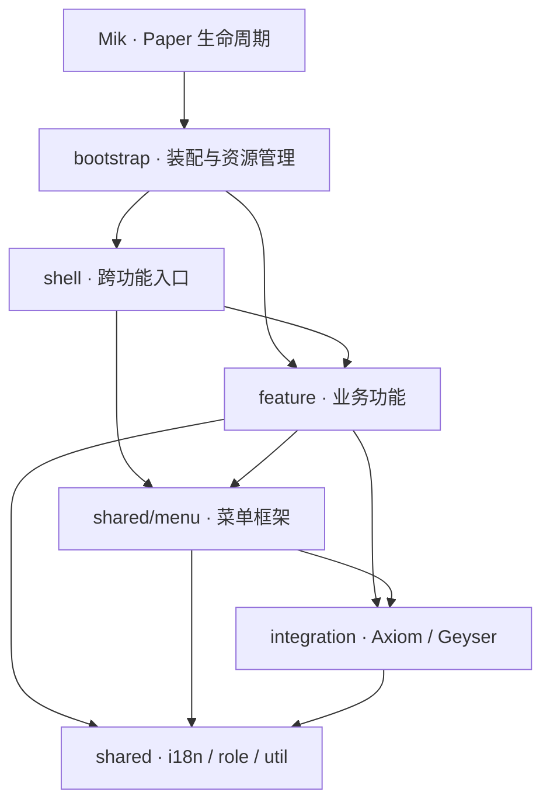

# 项目功能架构

代码按职责层、业务领域、具体功能组织。功能维护自己的规则和数据，`bootstrap` 负责创建对象并连接跨功能能力。

MIK 由 Paper 插件与 Linux 上的 `mikd` 组成。本页说明代码归属和进程边界；运行参数及首次部署见 [Linux 部署手册](../deploy/mikd/README.md)。

## 进程边界

| 领域 | `mikd` | Paper 或网站 |
| --- | --- | --- |
| [聊天与社交](chat.md) | 接纳共享消息、受众、持久化与分发；网页聊天会话、QQ 和 Matrix | Paper 拥有服内解析、受众、投递和呈现；网页负责界面与本机缓存 |
| [账号与身份](account-security.md) | 外部绑定、成员证据与网页登录确认 | Paper 保管游戏密码并执行准入；MikData 管理网站账号、Passkey 与会话 |
| [社区治理](governance.md) | 规则、名册、任期、投票与待交付权限 | Paper 上报游戏事实，执行并确认 LuckPerms 变更 |
| [公告](announcements.md) | 最近更新日志与 HTTP 读取 | Paper 主菜单预览和日志浏览 |
| [AI 助手](ai.md) | 模型与只读工具编排、公开知识检索、有序回复、短期会话和独立的玩法偏好 | Paper 命令、私有回复，以及游戏工具的定义、授权与执行 |
| [音乐](music-architecture.md) | 曲目身份、目录与外部曲单、原件、音源、媒体版本和歌词 | 歌单、唱片、游戏设备、播放输出、音游 |
| [插件控制台](../deploy/mikd/README.md#插件控制台) | 提供方目录、会话、命令和日志查询路由 | 插件定义控制台能力，执行命令并查询可用日志 |

共享契约在 [`proto/mik/`](../proto/mik/)，Java 和 Rust 从同一份定义生成类型。Paper 的 [`integration/mikd/`](../src/main/java/org/encinet/mik/integration/mikd/) 适配异步协议，功能通过自己的能力接口使用它。

- **IPC：** Linux Unix socket，连接时检验内核对端凭据。控制通道使用 v1 握手，角色和帧格式见 [transport.proto](../proto/mik/transport.proto)。状态及公开投影使用基础能力；助手、聊天消息（`chat-messages.v1`）、网页登录回执和治理交付各自协商业务能力。不匹配时拒绝对应业务，不回退到旧写入语义；状态与未受影响的操作仍可用。游戏状态、聊天上行和聊天下行各用独立通道；账号核验不与玩家资料和 AI 工具查询排队。音乐目录、媒体租约与歌词共用独立的 Paper 音乐 socket；主机管理使用另一条仅管理员可访问的 socket，按操作分配并发额度。UID 校验隔离进程，同一 JVM 中的插件共享游戏进程身份。
- **主机运维：** `mikd admin` 按文件权限和对端 UID 连接本机管理 socket。终端界面与脚本共用管理客户端，领域服务执行写入。标准部署通过 systemd 启停 `mikd.service` 并查询其 journal，服务器控制台由插件通过 IPC 提供。操作见[部署手册](../deploy/mikd/README.md#本机运维)。
- **请求与重连：** Paper 通道使用有界队列和超时，断线退避重连；快照积压时以最新值替换未发送版本，不重放已发送的写入。超时不代表事务未提交；有持久回执的操作按请求标识确认结果。不要用增加无界队列掩盖下游积压。
- **游戏状态：** Paper 每十个游戏刻在主线程采样。从同一份本地名单投影公开名单和带游戏可见范围的聊天名单，经 `PAPER_STATE` 与公开指标一起上报。Web API 和 Social 读公开名单，聊天读内部名单。首次发送完整名单，同连接只重发变动的名单。断线后后台立即使对应游戏投影失效；没有收到新采样时，公开状态保留五秒，聊天名单保留三秒。公开状态不用于授权，封禁、凭据与账号策略仍按需查询。
- **存储：** 每份数据只有一个运行时写入方；启动只接受当前格式，不自动转换旧数据。

### mikd 内部

| 位置 | 职责 |
| --- | --- |
| [`admin/`](../services/mikd/src/admin/) | 运维命令入口和 systemd 适配。`tui/` 维护页面、表单、导航和异步操作状态。命令行和 TUI 共用管理协议。 |
| [`bootstrap/`](../services/mikd/src/bootstrap/) | 参数解析、服务装配、监听器与后台任务调度。Paper IPC 主监听器失败会停止服务。可选的 Web 监听、AI 和音乐初始化失败不会关闭核心 IPC；私有 HTTP API 不可用时，其依赖的网页聊天监听也停用。社交连接失败不关闭 Paper 和 Web 接口。停机先回收监听和后台任务，再关闭领域存储。 |
| [`console/`](../services/mikd/src/console/) | 注册控制台，按提供方与会话派发命令和日志查询，校验回执。 |
| [`domains/`](../services/mikd/src/domains/) | 各领域拥有自己的规则、数据与应用操作。`community/identity/` 处理绑定与资格；Social 只提供平台成员证据和平台交互。`access.rs` 处理网页登录确认，并组合社区角色与 Paper 账号事实。 |
| [`domains/chat/`](../services/mikd/src/domains/chat/) | `service/` 接纳不同入口的提交，统一应用可见上限、解析待确定的身份并写入历史；`presence.rs` 持有游戏名单投影，`web/` 持有网页会话及其只读在线名单。纸端 IPC 和社交适配消费已保存的记录，不接管历史。 |
| [`domains/social/`](../services/mikd/src/domains/social/) | 共享聊天路由与命令；`platform/qq/` 和 `platform/matrix/` 各自维护配置、客户端与消息呈现。第三方内容审查及供应商适配归 `platform/qq/moderation/`。 |
| [`domains/ai/`](../services/mikd/src/domains/ai/) | 玩家助手的回合、模型审查、工具和公开知识。内部模块及其与 Paper、社交平台的边界见 [AI 助手内部](#ai-助手内部)。 |
| [`transport/`](../services/mikd/src/transport/) | `socket.rs` 共用监听与对端校验；`control/` 保管插件控制通道的握手、请求分发、会话状态与测试；`music.rs`、`admin.rs` 各管理自己的 socket 协议。业务服务由 `bootstrap` 注入。 |
| [`web_api/`](../services/mikd/src/web_api/) / [`game/`](../services/mikd/src/game/) | 私有 HTTP 路由；游戏状态投影与按需查询。网页聊天授权、历史与 WebSocket 实现在聊天域内。 |

### 插件控制台

插件通过 [`ConsolePort`](../src/main/java/org/encinet/mik/integration/mikd/ConsolePort.java) 注册控制台，声明命令输入、日志查询或两项能力。[`console.v1`](../proto/mik/console.proto) 使用实例名和提供方 ID 标识控制台，用插件启动标识配对同一提供方的两条连接。每项能力独立占用连接和待处理额度，收发均经现有 IPC 校验与重连。

`mikd` 按提供方和连接会话派发，每个回执只在收到对应请求的连接上生效。已派发的命令遇到回执丢失，结果标记为待核实。日志提供方接受最新、向前和向后的查询，负责分页、游标、可读范围和错误反馈。TUI 管理提供方选择、命令表单和当前日志页，CLI 使用同一个本机管理客户端。

Paper 原生控制台是当前提供方，由 `bootstrap` 装配。其 [`feature/server/console/`](../src/main/java/org/encinet/mik/feature/server/console/) 在主线程提交原生命令，在独立后台连接读取当前日志及归档。其他功能可以用相同接口注册自己的命令或日志实现。

### AI 助手内部

`mikd` 的启动、Paper IPC 和社交命令通过 [`domains/ai/mod.rs`](../services/mikd/src/domains/ai/mod.rs) 使用助手，不直接调用模型、检索或会话实现。

| `mikd` 模块 | 职责 |
| --- | --- |
| [`assistant/`](../services/mikd/src/domains/ai/assistant/) | 管理回合接收与生成容量。`paper/` 负责轮询、取消和结果保留；`social.rs` 接入平台投递审查；`receipt.rs` 在确认送达后提交历史并尝试投递记忆任务。生成结束即释放容量，不等待发送或记忆。 |
| [`conversation/`](../services/mikd/src/domains/ai/conversation/) | 按平台、实例或账号、会话、Matrix 主题串和玩家隔离短期历史。只提交确认送达的回复，迟到的旧回执不覆盖新历史；不写磁盘。 |
| [`memory/`](../services/mikd/src/domains/ai/memory/) | 送达后独立提炼和复核 Paper 长期记忆。SQLite 按实例与玩家隔离，批量提交后更新有界内存快照，不存对话正文。提问只尝试读快照，不等待锁、队列或数据库。 |
| [`agent/`](../services/mikd/src/domains/ai/agent/) | 在时间和调用预算内运行一个 Rig 模型／工具循环。不预先分类请求，也不评价整条回答的完成度。工具按入口注册；`guards` 只在需要外发搜索关键词时独立检查。 |
| [`agent/tools/`](../services/mikd/src/domains/ai/agent/tools/) | 维护知识和网页工具；`paper.rs` 按本轮 Paper 提供的定义注册游戏工具，不维护游戏工具清单或业务解析器。各工具共用执行预算；经校验的引用由回合统一分配标识，超出输出预算的结果不登记引用。 |
| [`model.rs`](../services/mikd/src/domains/ai/model.rs) | Agent 和记忆共用的模型客户端、请求边界和容量分配。后台调用在交互容量用满时让位。 |
| [`knowledge/`](../services/mikd/src/domains/ai/knowledge/) | 本服公开资料索引和 Minecraft Wiki 检索。站点、语言、网络请求和缓存由各自的 Wiki 实现维护。 |
| [`reference.rs`](../services/mikd/src/domains/ai/reference.rs) | 检索、工具与正文共用的引用类型和 HTTPS 地址规范化；是否有资格成为点击目标仍按当前回合的工具证据校验。 |
| [`reply/`](../services/mikd/src/domains/ai/reply/) | `markdown/` 分开解析块与行内片段、校验交互目标、限制文档规模；`layout.rs` 和 `visible.rs` 提供纯文本降级与可见历史。各端渲染同一份正文，不从历史重建富文本。 |

Paper 的 [`feature/community/ai/`](../src/main/java/org/encinet/mik/feature/community/ai/) 中，`AiModule` 注册命令、事件和轮询；`turn/` 管理主线程回合、权限复核与追问授权；`chat/` 将结果渲染为 Java 或基岩聊天组件；`game/` 管理工具目录、调用与原版状态读取。建筑、地段和电梯工具各随其功能维护，由 `bootstrap` 装配。QQ 和 Matrix 的专属展示与交互留在 `domains/social/`，不进入游戏代码或模型工具层。

| 协议文件 | 用途 |
| --- | --- |
| [`assistant.proto`](../proto/mik/assistant.proto) | Paper 与 `mikd` 的回合接收、轮询、取消、送达确认和失败原因。提问可带本轮工具目录，等待可带供应商明确提供的推理摘要。Paper 在本地估算并呈现进度。 |
| [`assistant_document.proto`](../proto/mik/assistant_document.proto) | 经验证的有序富文本正文。交互目标是行内片段的一部分；不定义固定回答结构，也不是模型的输出 schema。 |
| [`assistant_tool.proto`](../proto/mik/assistant_tool.proto) | 通用工具描述、调用与结果。参数是 JSON 对象；结果可为任意 JSON 值并附公开引用，不定义任何游戏业务字段或正文格式。 |

Paper 生成回合 ID，提问、轮询、取消和确认使用同一 ID，受连接的实例与玩家约束。第一次轮询取得正文时开启独立的确认期限。Paper 在调用 `sendMessage` 后异步确认；QQ 和 Matrix 在 SDK 确认发送后提交。下一次提问可带上已显示但待确认的上一轮 ID，过期或丢失不影响新一轮。IPC 断线后只恢复原回合的查询或确认，不重提问、不重显正文；重复确认不会追加历史。

任意有可展示内容的回复均可交付，不检查完成度，也不会用中间工具观测补造回复。确认发送后才记录短期语义历史；它不是客户端逐字渲染日志。Paper 送达回执另投递一份仅含当轮问题的记忆任务。独立后台队列读取对应玩家的已有记忆，提炼并复核后写入；分析不占玩家回合，模型容量紧张时让位。复核或数据库故障只影响记忆；数据库会定期尝试恢复。

Paper 在提问时只附本玩家当前可用的 `game_` 工具说明和输入 schema，不采集游戏数据。各功能拥有工具的参数校验、数据范围、返回字段及公开引用；新增工具或字段不需要改 `mikd` 或共享协议。公共状态快照仍供 Web API 和聊天等既有业务使用，不直接提供给模型。

模型只填工具参数；实例、玩家和回合由 `mikd` 绑定，经已有游戏查询队列按实例路由。Paper 只执行本回合已声明的工具，主线程在采集前和后台查询完成后检查当前连接、回合与权限。建筑匹配和分页在查询线程读取不可变目录快照；电梯方向保留「未知」，不把它当成「不可达」。`mikd` 只限制工具预算并校验公开 HTTPS 引用；查询不可用时仍由模型决定能回答什么，不把工具结果自动追加到正文。

Paper 在本地决定如何呈现原生控件，不上报客户端聊天类型，也不影响游戏读取授权。各端按 `blocks` 和片段顺序呈现；追问提交文字本身，不携带另一条指令。Paper 复核原版物品 ID 和公开 HTTPS 目标，不执行 MiniMessage 或游戏命令。QQ 与 Matrix 的特有渲染分别在各自的 `assistant/` 和 `assistant.rs`，请求走独立于普通聊天、命令的有界队列。QQ 所有待发送版本先通过[出站内容审查](chat.md#qq-内容审查)，送达结果不明时不重发替代版本。Paper 与 `mikd` 均需声明 `assistant-turns.v9`，不回退到旧助手协议。

MikWeb 发布本服 Wiki，`mikd` 只同步公开摘录。原版资料由独立的 Minecraft Wiki 适配读取：以站点清单定义语言、规范地址和 API；各语言版分别刷新标题索引、缓存正文，查询只访问选中的本地目录及有限回退。正文只用本轮命中的公开页面编号读取，不向 Wiki 发送搜索词。`mikd` 在提供本轮引用前校验站点和规范地址。不把 Wiki 证据用于实时权限判断。参见 [AI 助手](ai.md#wiki-资料)。

可选的[网页搜索](ai.md#网页搜索)在模型调用无参数搜索工具时，仅从当前玩家问题提取公开关键词，校验后才发往固定 Tavily 端点。搜索不接收历史、记忆、游戏观测或模型指定的查询参数。三个入口共用客户端、并发限制和限流暂停状态。网页、Wiki 和公开建筑的引用最终使用同一种链接片段，不授予游戏能力。

## 职责层

以下路径相对于 `src/main/java/org/encinet/mik/`。

| 位置 | 负责 | 使用边界 |
| --- | --- | --- |
| `Mik.java` | Paper 生命周期与 Plasmo Voice 注入 | 只调用 `MikRuntime` |
| `MikLoader.java` | 为插件类加载器声明运行时库 | 不创建业务功能 |
| `bootstrap/` | 创建功能、传入能力、注册命令、管理启停 | 可引用功能装配类；业务功能不引用此层 |
| `feature/<领域>/<功能>/` | 功能规则、状态、存储、事件、命令和页面 | 通过能力接口、数据类型或回调调用其他功能 |
| `shared/` | 多功能共用的语言、菜单、角色定义与工具 | 不依赖业务功能或跨功能入口 |
| `integration/` | 多功能共用的外部插件协议与 API 适配 | 不依赖业务功能；可使用共享服务 |
| `shell/` | 聚合多个功能的菜单、网页和脚本入口 | 调用功能提供的能力，不接管功能状态 |

`shared/menu` 通过 `integration/axiom` 呈现；`integration/geyser` 提供基岩玩家识别。依赖检查以具体能力包为单位。

## 功能地图

### 玩家：`feature/player/`

| 功能包 | 职责 |
| --- | --- |
| `address/` | 玩家地址记录、最近访问查询、关联账号通知 |
| `afk/` | 自动与手动 AFK、活跃证据、抑制租约、观看状态 |
| `client/` | 客户端版本与模组查询能力；`detection/` 管理检测，`tip/` 读取结果生成建议 |
| `guidance/` | 场景提示声明、事件订阅、调度与展示策略；见[场景提示](guidance.md) |
| `mode/` | 游戏模式切换所需的客户端权限状态同步 |
| `movement/` | 飞行、速度和世界边界约束 |
| `presence/` | 欢迎、加入与退出通知、隐身状态通知 |
| `security/` | 密码凭据、登录验证、重置授权与审计；见[账号安全](account-security.md) |
| `profile/` | 玩家身份组件、名牌与 Tab 展示；`nametag/` 维护[自定义名牌](name-tags.md) |
| `pvp/` | 玩家战斗偏好、覆盖规则、战斗判定及受保护攻击的场景提示 |
| `effects/` | 非战斗中创造与旁观玩家的[负面效果提醒和清除](guidance.md#负面效果清除) |
| `teleport/` | 家、返回、传送偏好与同意请求、管理员强制传送；自有操作与聊天场景提示 |
| `trash/` | 私人垃圾箱命令、原生大箱子菜单、整理、清空与关闭后的延时清理 |
| `utility/` | 主城、帽子、掉落物清理、自助退出等日常命令与提示 |

游戏姓名与外观由 `profile` 维护，外部账号绑定归社区 `identity`。客户端检测通过 `ClientVersions`、`ClientMods` 暴露只读快照，提示、菜单和 Skript 消费这些接口，见[客户端检测](client-reminders.md)。DreamDisplays 适配随 AFK 功能维护，见[观影会话](afk.md#dreamdisplays-实体屏幕观影)。

`/tpforce` 复用原版 `/tp` 的参数与补全，供 `group.moderator`、`group.custodian` 忽略传送偏好和挂机限制。普通 `/tp`、`/teleport` 与 `/tpforce` 均拒绝裸写的 `@e`；带条件的 `@e[...]` 及其他选择器遵循原权限。代理在功能内使用独立原版解析器，公开命令注册普通参数节点。

### 社区：`feature/community/`

| 功能包 | 职责 |
| --- | --- |
| `ai/` | 游戏 `/ai`、私有回复和授权后的只读游戏查询；见 [AI 助手内部](#ai-助手内部) |
| `chat/` | 服内频道、即时发言、富文本、物品与玩家提醒；异步上报及接收后台下发，见[聊天与社交](chat.md) |
| `communication/` | [公告](announcements.md)的游戏内预览与阅读，从 `mikd` 读取日志 |
| `governance/` | 治理菜单、游戏事实采集和 LuckPerms 交付；成员资格、任期与投票由 `mikd` 所有，见[社区治理](governance.md) |
| `identity/` | 绑定命令、验证码提示和绑定列表，仅调用 `mikd` |

`ChatModule` 装配 Paper 即时聊天，`CommunityFeatures` 连接名单投影和 IPC 桥。`GameChatDirectory` 持有名单及可见性规则，`GameChatSessions` 提供本地输入能力、物品及呈现快照，`GameChatService` 确定实际收件人和共享去向。`render/` 不读取 Bukkit 状态；`bridge/` 转换名单、消息和投递条件。游戏侧不依赖桥接实现或 Protobuf。涉及跨端投递与断连的行为见[聊天文档](chat.md)。

Paper 治理功能的 `command/` 管理命令和菜单，`membership/` 保管游戏侧活动采集和成员视图，`delivery/` 执行并确认后台下发的变更。它们通过 `gateway/` 访问 `mikd`。

### 世界：`feature/world/`

| 功能包 | 职责 |
| --- | --- |
| `buildings/` | 同步、校验与缓存公开建筑目录，提供同世界查找；Pl3xMap 兴趣点和双语信息卡为可选发布 |
| `heads/` | [装饰头颅](decorative-heads.md)的目录同步、索引、玩家外观、收藏、领取与空间菜单 |
| `plot/` | 地段与子地段、传送点、区域编辑、权限、公告板和预览 |
| `regen/` | 世界更新计划、区块捕获、预览、异步计算与应用 |
| `space/` | 非欧几里得空间、表面、连接、穿越与索引 |
| `elevator/` | 物理平台与楼层、共享目录发现、玩家访问与群组移动、固定面板安放及呈现 |
| `vehicle/` | 载具定义、模型编辑、物理、驾驶与仪表盘 |
| `riding/` | [生物骑乘](vehicles.md#生物骑乘)、方向键驾驶与生物自主行为恢复 |
| `spawn/` | 出生点信标颜色设置 |

世界功能维护自己的编辑草稿、预览和运行资源，操作提交时复核目标与权限。具体结构见[铁电梯](iron-elevator.md)和[载具](vehicles.md)。载具专用 Axiom 适配位于 `vehicle/integration/axiom/`，共用的 Gizmo 和图片注解适配位于全局 `integration/axiom/`。

### 娱乐：`feature/entertainment/`

| 功能包 | 职责 |
| --- | --- |
| `music/` | 统一目录视图、唱片与设备、播放输出、字幕、节奏游戏和界面 |
| `event/` | 周年活动及抽奖规则 |

音乐的模型、应用、设备、存储、音游与界面分工见[音乐架构](music-architecture.md)。娱乐功能通过 AFK 活跃能力上报玩法输入。

### 服务器管理：`feature/server/`

| 功能包 | 职责 |
| --- | --- |
| `access/` | 维护模式、使用限制、绑定准入和在线撤销的游戏侧执行 |
| `auth/` | 正版认证容灾、已验证身份与来源地址缓存、Paper 认证服务接入与恢复；见[认证容灾](account-security.md#正版认证容灾) |
| `ban/` | 封禁规则、记录、准入检查和 Paper 封禁同步 |
| `console/` | Paper 原生控制台输入与日志文件查询 |
| `monitor/` | 管理员加权公平轮换旁观、附近跟随、退出恢复与隐身通知排除能力；见[管理员监控](server-monitor.md) |
| `performance/` | 性能信息、网络反馈限流与跑图保护；见[网络出口](network-egress.md) |
| `presentation/` | 服务器品牌、MOTD、服务器列表和链接 |
| `safety/` | 物品与书页限值、实体大小、末影珍珠、踩踏、液体、爆炸、危险实体和异常保护；见[世界安全保护](server-safety.md) |

社区治理可以调用封禁能力交付结果，但封禁功能不依赖治理。物品事件拦截和网络包处理共用同一套限值规则，各自处理所属协议或事件格式。

## 共享能力与入口

| 位置 | 所有权 |
| --- | --- |
| `shared/i18n/` | 消息键、语言选择、语言变更通知；译文在 `src/main/resources/lang/` |
| `shared/menu/` | 场景与导航、组件布局、图片、输入和显示资源；见[菜单架构](spatial-menu-design.md) |
| `shared/role/` | 玩家角色和权限组名称 |
| `shared/util/` | 调度、协议、地理查询、玩家姓名缓存解析、显示工具和独立清理步骤 |
| `integration/axiom/` | 共用 Gizmo、临时图片注解协议、差量同步和资源作用域 |
| `integration/geyser/` | 可选 Geyser 接入与基岩玩家识别 |
| `shell/menu/` | 主菜单、语言菜单和分类设置宿主，嵌入功能提供的 `MenuPanel` |
| `shell/mikd/` | Paper 游戏查询适配与后台状态命令，不承载 HTTP 或网页登录会话 |
| `shell/skript/` | 将现有功能能力暴露为 Skript 表达式与效果 |

## 装配与生命周期

`bootstrap` 中的装配组按实际依赖顺序启用：

1. `MikRuntime` 启用品牌监听并写入异常退出标记。
2. `SharedServices` 创建 Axiom、Geyser、语言服务与菜单运行时。
3. `PlayerFeatures` 首先启用账号密码准入，再创建玩家状态、地址、身份展示和个人功能；独立创建客户端检测能力，再启用场景提示服务并注入检测查询，为客户端、家园等场景托管提示作用域。
4. `ServerFeatures` 接入正版认证容灾，创建封禁、监控、准入、安全、性能和服务器展示；将监控会话查询注入隐身通知，发现旧标记时恢复维护模式。
5. `CommunityFeatures` 创建游戏端 AI 适配、绑定、聊天、治理与公告入口。
6. `WorldFeatures` 创建世界功能，为铁块电梯注入固定面板和场景提示作用域。
7. `EntertainmentFeatures` 创建活动和音乐，接入语音、AFK 与只读地段授权能力。
8. `EntryPoints` 连接主菜单、语言菜单、可选 Skript、游戏查询与网页登录命令。

装配组为包内类型，通过返回记录传递已创建对象；功能运行时使用注入的能力。

`ModuleLifecycle` 登记成功启动模块的关闭动作，也通过 `own` 托管构造前分配的独立资源，例如提示作用域。若某个模块启动失败，先调用该模块的关闭动作，再由 `MikRuntime` 逆序关闭此前已启动的模块与资源并取消插件任务。独立关闭步骤继续执行，错误附加到启动异常，便于定位原始失败与清理失败。

正常停服同样逆序关闭，然后卸载 Plasmo Voice 扩展。只有启动完整、全部关闭成功且语音扩展卸载成功时，`MaintenanceCrashMarker` 才删除标记。各功能内部的多个关闭步骤可使用 `ShutdownSequence`，执行完其余步骤后报告失败。

## 数据与线程边界

- 功能独占存储，通过能力提供查询和操作；调用方不直接读写其数据库或状态文件。
- Bukkit 状态在主线程读写，HTTP、文件和耗时计算在后台执行，跨线程传递不可变快照。异步结果提交时复核会话、目标与权限。
- 任务、线程、连接和临时显示随所属功能关闭。提示作用域及显示资源的通用清理由共享服务负责。
- 菜单页面归创建它的功能，通过 `FloatingMenuHandle` 操作当前会话；全局菜单查询用于核对回调目标。
- 持久状态加载失败时报告错误并保留原文件。

## 并发与性能

- `mikd` 和 Paper 的独立操作应能并行；只在同一资源的写入、Bukkit 状态和其他有顺序要求的边界串行。网络等待不持有供其他操作共享的状态锁。
- 按连接、任务和下游资源设置容量。长任务与短查询分配独立额度，超载时及时拒绝、合并或退化，不把排队压力转移给游戏线程。
- 重复读取优先复用快照或合并进行中的任务。跨进程传输批量数据，避免让每个 tick 或每个媒体块都走通用控制链路。
- 变更热路径时验证关键并发场景；吞吐和延迟结论基于测量，不以线程数或单机测试代替实服容量。

## 增加功能时如何选择位置

先确定数据和规则由谁维护。新能力扩展现有功能时，放回该功能；只有独立的规则、状态或生命周期才新增 `feature/<领域>/<功能>`。功能内部再按实际职责拆分，例如规则、存储、协议和页面，不要求每个小功能都创建同样的空目录。

多功能共用且不依赖业务状态的机制进入 `shared`。跨功能共享的外部插件适配进入 `integration`。只服务一个功能的适配、算法或持久化类型保留在所属功能。跨功能导航和外部入口进入 `shell`，对象创建和能力连接进入 `bootstrap`。

跨功能依赖应引用所需的能力接口、数据或回调，避免导入对方的 `*Module`。`bootstrap` 和 `shell` 可以访问装配入口；功能、共享服务和通用适配不能反向引用它们。

## 测试约定

Paper 的功能测试随生产包组织；实际启动后台的跨进程检查随 [`integration/mikd/` 测试](../src/test/java/org/encinet/mik/integration/mikd/)维护，协议夹具仍在 [`tests/interop/`](../tests/interop/)。运行命令和报告位置见[构建与验证](../README.md#构建与验证)。

- 行为测试通过真实方法、命令解析器或存储接口检查权限、边界输入、失败处理和持久化；测试输入应能实际触发被验证的问题。
- 架构测试检查目录与包名、功能归属、依赖方向、公开能力边界和依赖无环，避免锁定局部变量名、内部文件清单或源码片段。
- 通用语言资源由 `LanguageResourcesTest` 统一验证；功能测试补充特有的参数和展示行为。翻译调用与资源顺序由 `tools/i18n/audit.py` 检查。
- 性能测量使用 `@Tag("benchmark")`，通过 `./gradlew benchmark` 单独运行。缓存复用等可确定的行为仍由默认测试验证。
