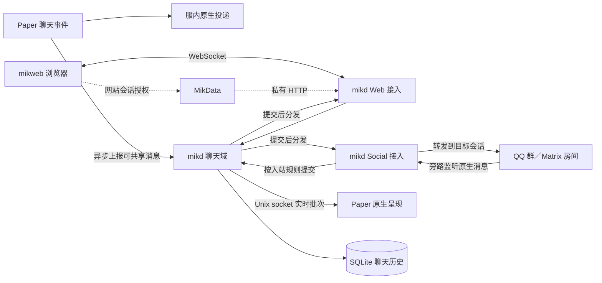

# 聊天与社交互通

Paper、QQ 和 Matrix 各自投递原生聊天，不等待 `mikd`。`mikd` 负责共享消息的处理、历史与转发，不经 Paper 中转。Web 没有独立的原生聊天后端，直接由 `mikd` 服务；Web 与 QQ／Matrix 的 Social 接入共用同一个聊天核心。

## 职责与接口

| 组件 | 负责 | 不负责 |
| --- | --- | --- |
| Paper | 原生聊天事件、服内频道和收件人、可见性、名牌、物品组件、游戏内通知；通过 Unix socket 上报可共享消息并接收外端消息 | 网页会话、跨端历史、机器人会话与第三方审核 |
| `mikd` 聊天域 | 统一消息模型、共享正文归一、历史、受众与实时分发 | Minecraft 组件、浏览器界面或机器人 SDK |
| `mikd` Web 接入 | WebSocket、聊天授权与撤销、HPKE、网页发言和历史查询、网页在线状态 | 网站登录、Passkey 与网站会话 |
| `mikd` Social 接入 | QQ／Matrix 登录、事件转换、会话路由、命令、成员证据和消息呈现；QQ 额外负责出站审查 | 不定义第二套共享消息、权限或历史；不桥接管理频道和私聊 |
| `mikweb` / MikData | 网页显示、通知与本机缓存；MikData 校验网站会话后请求 `mikd` 授权 | 不经 MikData 或其他平台转发聊天正文 |



- **Paper → 外端：** 服内按原生事件投递，不等共享写入。上报以其他插件编辑后的最终正文和接收范围为准。普通原生消息的接收范围被缩小时留在服内；允许共享但受到隐身等可见性约束的记录携带明确的可见范围，不进入公共机器人桥。后台不把 Paper 发言再发回 Paper。
- **仅网页在线的私聊对象：** Paper 提交前核对网页在线名单、账号准入、双方可见性及原生事件的最终受众，不借网页绕过游戏侧的受众限制。频道聊天只把发送者的原生回显标作「待确认」，`/msg` 和 `/r` 等直接发送在共享历史保存后才回显。提交和反馈均绑定原游戏会话；游戏可直达时照常即时投递，不等共享回执。
- **QQ／Matrix → 各端：** 平台原频道照常投递，机器人旁路监听，处理命令或按会话规则提交可共享消息。目标端独立消费已提交的消息；机器人不回发到来源会话，也忽略自身事件。
- **Web → 各端：** 玩家从网站 `/chat` 进入，以登录的 Minecraft UUID 向 `mikd` 发言。回执只确认共享历史已保存，不等待 Paper、QQ 或 Matrix 送达。游戏可用 `/msg`、`/r` 回复私聊。
- **在线事件：** 游戏加入退出由 Paper 上报；网页加入退出按同一玩家首个授权连接和最后一个断开连接生成。加入退出可进入共享时间线，但不产生未读提醒。[公告](announcements.md)是独立展示的更新日志，不进入聊天。
- **Paper 下行：** `CHAT_DOWNLINK` 每次拉取一个有界的实时批次，在游戏主线程完成显示后再拉下一批；没有逐条回执，也不在重连时补发历史。`PAPER_STATE` 独立同步游戏名单与网页连接汇总，聊天拥塞不会阻塞状态采样。

## 频道与可见性

| 频道 | Paper ↔ Web | QQ／Matrix |
| --- | --- | --- |
| 公共 | 在可见范围内共享 | 仅无受众限制的公共发言，且符合目标会话配置 |
| 管理 | 仅有管理频道权限的接收者，读取与下发时仍检查权限 | 不接入 |
| 私聊 | 只对明确参与者可见；网页新发私聊的目标须对本人可见，且在游戏或网页在线 | 不接入 |

网页在线名单遵循 Paper 可见性。一个 UUID 的多个网页连接在游戏 Tablist 合并为一条记录，不计入游戏在线人数或原版命令补全。已绑定的外部作者沿用同一 UUID 的可见性；Paper 名单过期或不可用时，不会把该作者当作未绑定用户公开转发。未绑定作者仍可在已配置的公共桥发言，但只以外部身份显示，不会成为 Minecraft 私聊对象。平台绑定、成员证据及入服准入见[外部身份绑定](account-security.md#外部身份绑定)。

网页发送单行文本，最多 256 个 Unicode 字符；按 UUID 独立限流，初始可发三条，每两秒恢复一条，重新连接不会清空额度。Paper 使用自己的本地发言规则。

## 消息语义与渲染

**接入端解释输入，`mikd` 统一共享语义，目标端决定呈现。** [chat_message.proto](../proto/mik/chat_message.proto) 中的 `ChatBody` 是共享记录唯一的正文：按顺序排列的 `ChatPart`，可以是文字、链接、提及、物品标签或附件说明，并可带样式。[chat.proto](../proto/mik/chat.proto) 的 `HistoryEntry` 承载记录、频道、参与者与可见范围，供提交、历史和下行使用，不再附带另一份原始文本。作者身份、来源和权限由可信接入端确定，不由正文声明。

### 接入端：解析原生输入

- **Paper：** [ChatProcessor](../src/main/java/org/encinet/mik/feature/community/chat/pipeline/ChatProcessor.java) 用本地修改器识别普通 URL、邮箱、玩家提及、手持物品和背包槽。受限 MiniMessage 和 `@all` 只有获得对应能力才解释。这条路径只依赖游戏侧的上下文，不请求 `mikd`。上报时，`ChatRecordCodec` 将最终正文映射为共享节点：物品仅上报展示文字，不携带物品数据或可执行的点击命令。
- **Web：** `mikd` 接收玩家提交的文本。网页不解释 MiniMessage、物品标记或群体提醒。
- **QQ／Matrix：** 适配器把平台事件里的原生提及、可保留的链接和附件等转成语义节点，再按入站规则提交。Matrix 从清理后的富文本保留粗体、斜体、下划线、删除线和前景色；剧透内容用占位符代替。外部身份使用 `platform + issuer + scope + subject`，事件按来源会话区分，不按昵称去重。附件和转发只保存类型及说明，不复制文件或转发原文；回复和线程引用是来源元数据。

### 聊天域：归一共享正文

[links.rs](../services/mikd/src/domains/chat/links.rs) 在共享消息写入前处理链接。HTTP(S) 地址、邮箱和已知站点的不带协议地址可转成链接节点；Bilibili、GitHub、Minecraft Wiki、Mojira、Matrix 的链接可附上资源分类。BV／AV、`MC-…`、`matrix:` 和 Matrix 标识也可转换为可点击 URL。已有链接保留标签和目标，只更新分类；不会在标签中重新识别链接或提及。站点分类和短写规则只在 `mikd` 维护，不联网、不抓取标题或卡片，也不回写原生聊天。

链接归一后，聊天域只在剩余文本中解析提及。Web 按发件人可见的名单把 `@玩家名` 转为 UUID；对不受限的 Paper 公共发言，可补全已绑定但不在当前游戏名单里的玩家提及。QQ／Matrix 的原生提及在接入时就携带外部身份，能找到绑定则关联 UUID。身份只确定提及的是谁，是否提醒由目标端决定。

例如，在 Paper 输入 `看 MC-12345`，服内照常显示原文；`mikd` 在共享副本中把它转换成一个链接节点，包含标签 `MC-12345`、Mojira URL 和资源分类。Web、Matrix 和 QQ 可显示可点击标签，纯文本回退保留实际地址。从 Web 发出同样内容时，Paper 直接渲染收到的链接节点，不必再识别 `MC-…`。**统一的是共享副本的含义，不是所有来源频道的显示。**

### 目标端：按能力呈现

| 目标 | 消费共享节点的方式 |
| --- | --- |
| Paper | 转成 Minecraft 组件，支持点击链接、悬停和资源分类默认色；使用 UUID、实际收件人和游戏内偏好决定提醒。不把下行正文再交给本地输入修改器。 |
| Web | `mikd` 输出带文字、样式、`href` 和提及标记的片段，以及当前用户是否被提及；网页据此呈现。当前 Web 投影不包含链接资源分类。 |
| QQ | 普通消息用纯文本；有 HTTP(S) 链接、粗体、斜体、删除线或有效提及时选择群聊原生 Markdown。正文转义后显示，链接和原生 `@` 由共享节点生成。样式不受支持或富文本超预算时在发送前降级；不因发送结果不明确而另发一条纯文本。 |
| Matrix | 使用原生 HTML 显示普通链接、邮箱、样式和颜色渐变，保留可读的纯文本回退。能唯一定位到当前房间成员的提及使用 `m.mentions` 和用户链接。 |

入站前缀匹配平台解析后的文字；出站匹配共享节点的展示标签，不匹配隐藏的链接目标或平台标记。`strip` 只移除匹配的前缀及紧随的空白。被切到一半的节点按剩余文字显示，之后完整的链接和提及仍保留语义。

QQ／Matrix 只对能唯一定位的目标会话成员生成原生提醒。外部群体提及不会成为共享广播，Paper 的广播节点发到外端也只显示文字。纯文本回退优先保留正文标签，能放下才附完整链接地址。QQ 审查可送达的正文和富文本链接目标，不审查 Markdown 标记本身。

## 历史与失败语义

`mikd` 用 SQLite WAL（`synchronous=FULL`）保存共享记录，从写入起保留七天。聊天域使用一条写连接和两条有界的只读连接。写者按入队顺序把已经到达的消息合并到同一事务，不额外等候凑批；只有提交成功才回执和广播，单条冲突不会撤销同批其他有效消息。每个历史页在一次读事务内读取已提交快照，不排入写队列。历史查询接口只在 `mikd` 内部使用；Paper 接收实时消息，不读取历史。消息 ID、外部来源事件及网页请求标识用于去重；客户端不能直接读取全局序号。默认库位于 `/var/lib/mikd/chat-messages.sqlite`，含私聊明文，权限应保持 `0600`。运行时使用 SQLite 一致性备份或停服务后备份。

| 情况 | 行为 |
| --- | --- |
| 后台断连、入站满载或 Paper 可见性快照过期 | 原生聊天不受影响。无法接纳的共享副本不补写；已绑定身份缺少可见性依据时不扩大受众。 |
| 仅依赖网页的游戏私聊 | 按原消息 ID 核对持久保存回执。反馈区分「已保存到共享历史」「未保存」与「结果未确认」。已保存不代表对方收到或已读；结果不确定时先核对，不自动重发。反馈仅发给原发送者。 |
| 网页提交未确认 | 不能断定事务未提交。权限不变时，网页登录续期不影响在途回执。网页不自动重发未确认消息；相同发送者、请求 ID 和内容可查到原回执，不重复广播。 |
| Web 实时消费积压或网络断开 | 重新连接、授权和换新会话密钥后按游标补齐；历史补齐不会重播实时提醒。 |
| Paper 或 Social 实时消费积压 | 可能漏收；不回放普通消息或补发通知。投递失败或 QQ 审查拒绝不回滚历史，不阻塞其他平台。 |

已绑定的 QQ／Matrix 发言会短暂等待 Paper 的可见性快照。仍收不到时不发布，并记录快照不可用；这不是数据库写入错误。升级后在 Paper 控制台执行 `mikapi status` 确认连接，再从已绑定的社交账号发一条消息测试入站。

共享提交队列最多 32 项、1 MiB；写入成功才发布实时事件。每个社交接入先区分命令与转发，再分别进入有界队列；慢命令、引用查询和 AI 回复不占普通聊天的处理额度。入队不等待，满载丢弃该路工作，命令不会因此回退为聊天。Matrix 连接失效后丢弃旧会话的待处理事件。

网页、Paper 和各机器人会话独立消费有界广播。QQ 在出站时审查，总时限包含排队，命令回复至多占一个审查并发位。Paper 使用独立 IPC 通道长轮询下发，读写 Bukkit 状态时回到主线程。其余 IPC 边界见[项目架构](architecture.md#进程边界)。

### 网页历史同步

客户端通过已授权的加密 WebSocket 发送 `history` 请求，例如：

```json
{"type":"history","requestId":"0123456789abcdef","channel":"public"}
```

- `channel` 取 `public`、`staff`、`private`；私聊可用 `targetUuid` 缩小范围。`since` 使用上一轮完整同步的 `checkpoint`；`page` 使用本轮回应的 `nextPage`。
- 同一轮在固定快照中向旧记录翻页。响应中的 `messages` 从旧到新；即使当前页为空，有 `nextPage` 就须继续。整轮完成后才能提交新的 `checkpoint`。单页最多 256 条，消息数组最多 120 KiB。
- 游标是加密的不透明令牌，绑定账号、频道、目标、可见范围与数据库身份；服务端重启可继续使用。库替换或权限变化等导致游标失效时，`reset` 要求从新的可见快照开始。
- 实时和历史按消息 ID 合并；`order` 用于排序，`createdAt` 用于显示，`expiresAt` 表示服务端记录截止时间。查询失败可能返回 `history_unavailable`，可重试；查询不消耗发言额度。

网页可选用 IndexedDB 保存同步结果，在七天期限之后继续本机搜索和阅读。权限撤回清掉对应管理记录；退出网站或切换账号清除本机记录。分类清理不删除服务端历史或草稿；本机清除后，已超过服务端保留期的记录无法恢复。私聊与提及的浏览器通知需用户授权，只对实时在线消息生效。同一浏览器的标签页合并通知。

## 网页授权与传输

网页经同源 `POST /api/account/chat/authorize` 请求授权。MikData 校验网站会话，再通过私网调用 `mikd` 的 `/api/chat/authorize`；`mikd` 组合社区角色与 Paper 的实时账号事实。Paper 不接触浏览器的密钥和网站会话。授权租约最长 60 秒，同一网站会话的续验合并；退出或撤销会话时关闭连接，撤销通知未送达时最迟在租约到期后失效。

浏览器和 `mikd` 通过 WebSocket 二进制帧传输经 HPKE 加密的 UTF-8 JSON。长期签名密钥认证临时公钥；授权绑定到连接和浏览器公钥，Finished 确认持有私钥后才激活会话。协议标识为 `mik-chat-hpke-2026-11-13`，使用 P-256、HKDF-SHA256 与 AES-256-GCM。每 30 分钟或任一方向达到 16,384 条记录时在原连接内换钥；超时、篡改、重放或乱序会断开。应用入站上限 8 KiB、出站上限 128 KiB。默认同时最多 64 个已授权连接、每位玩家四个，另有待授权上限。

Tunnel 转发密文，仍可看到连接元数据。浏览器、网页代码、登录服务和主机是可信端点；服务端和本机记录不使用上述传输密钥加密。代理、Origin 与签名公钥的配置均见[网页接入部署](../deploy/mikd/README.md#网页接入)。

## 社交平台配置

将 [社交配置模板](../deploy/mikd/social.example.yml) 保存为 `/etc/mikd/social.yml` 即启用，凭据填在 `/etc/mikd/secrets.env`。QQ 与 Matrix 可分别启用，群与房间按平台 ID 配置；每个机器人账号只运行一个实例。状态保存在 `/var/lib/mikd/social/`。

| 会话字段 | 作用 |
| --- | --- |
| `inbound` / `outbound` | 独立启用公共聊天的两个方向；省略即关闭，`{}` 不要求前缀。可用 `prefix` 过滤，并用 `strip: true` 去掉前缀。 |
| `commands` / `ai` | 启用社交命令；`ai: true` 额外开放 `/ai`。会话按平台账号、会话和发送者隔离，见 [AI 助手](ai.md)。 |
| `membership` | 将群或房间设为入服资格证据来源，独立于聊天方向。身份服务负责判断资格和处理已确认的离群；未知证据不会撤销绑定。 |
| `locale` | 回复和附件说明的语言，默认 `en-US`；见 [Fluent 社交消息](localization.md#社交消息)。 |

在 `qq`、`matrix` 各自的配置段设置 `command_prefix: "/"` 或 `command_prefix: "!"`，省略时默认 `/`。同一平台的群或房间只执行带所选前缀的命令；聊天转发的 `inbound.prefix` 不替代命令前缀。用 `/help` 或 `/帮助` 查看命令；前缀为 `!` 时用 `!help` 或 `!帮助`。

`/online` 与 `/status` 使用 Paper 发布的公开名单和指标，不展示隐藏玩家。`/profile` 查询本人；查他人需要正式成员、管理资格或 Paper 确认的本地运维权限。在平台引用某条消息时，`/profile` 在当前会话解析被回复者，无法确认则不回退查本人；无需开启共享入站。绑定、解绑与 AI 指令不会因关闭命令而意外成为普通聊天。

### QQ

`qqbot-sdk-rs` 连接 QQ 官方机器人 Gateway。配置 AppID、群 OpenID 和 `MIKD_QQ_APP_SECRET`；机器人需要消息、主动群消息及所用成员事件权限。临时网关故障退避重试；凭据和权限错误应修正后重启。

已有 QQ 绑定入服时不查群成员名单。新绑定的成员证据来自可信的群消息、加入事件或成员名单。任一资格群的退群事件都会撤销该账号的 QQ 绑定；未收到事件时，不从成员名单反推退群，管理员可手动解绑。新 Gateway 会话或机器人离群会使旧证据失效，不影响已有绑定入服。

用 `approval_secret_env` 将群 OpenID 映射到 TOTP 密钥的变量名，密钥值填入 `/etc/mikd/secrets.env`，各群独立并与网站一致。网关申请事件和待审列表共用审批队列；遇到不明确的响应只重试仍在待审列表的请求，无法解码的申请留给人工。未配置时由管理员处理。

#### QQ 内容审查

在 `/etc/mikd/social.yml` 启用 `qq:` 后，所有配置的 QQ 群自动审查出站聊天和动态命令回复，包括 AI 回答、追问建议和链接目标。审查拒绝或服务不可用时不发送原内容；QQ 入站和共享历史照常工作。

Eden 返回的总体风险等级和分数均为 `0` 时按最低风险处理，明细仍逐项审查。审查接口返回无效响应时，`mikd` 日志记录供应商、模型、HTTP 状态和失败原因。Eden 的诊断会标明具体字段，并区分缺失、空值、类型错误和越界；不记录聊天内容、响应字段值、原始响应或密钥。

启用 QQ 后优先通过 OVH 审查，无有效判定才尝试已配置的备用路线。若 Eden 持续返回无效字段，在 `/etc/mikd/secrets.env` 注释掉 `MIKD_QQ_EDEN_API_KEY`，保留 OVH 配置并重启 `mikd.service`。这样只停用 Eden，不关闭审查；`MIKD_QQ_OVH_API_KEY` 留空时使用 OVH 匿名访问。重启后从游戏发一条普通消息测试 QQ 出站，用 `journalctl -u mikd.service --since "5 minutes ago" --no-pager` 查看本次日志。

### Matrix

`matrix-rust-sdk` 只在已配置且机器人账号已加入的端到端加密房间收发。配置 HTTPS homeserver、机器人 MXID 和房间 ID 后，用机器人账号接受邀请；`mikd` 不会自动加入房间。`MIKD_MATRIX_STORE_PASSPHRASE` 保护 SDK 库；首次登录使用 `MIKD_MATRIX_PASSWORD`，可用 `MIKD_MATRIX_RECOVERY_KEY` 恢复交叉签名和密钥。仅已验证的机器人设备桥接；重启时继续使用同一份状态目录和存储口令，不必重新验证。会话绑定 MXID 和 homeserver；会话被撤销时检查并注销旧设备，再用新状态目录建立会话，不复用旧 Java SDK 数据。

入站只转发 SDK 成功解密且发送设备通过交叉签名检查的事件；出站聊天和命令回复均加密，不回退为明文。`recipient_devices` 默认 `verified`，只给 SDK 信任的设备发送房间密钥；`cross_signed` 可接受由其账号交叉签名的设备。`verified` 模式下可在 `trusted_users` 配置独立验证过的交叉签名指纹；不匹配不信任，删配置不会撤销已写入 SDK 库的信任。首次及重连后的首批同步不桥接历史；正常同步中对迟到密钥短暂等待，失去连接或设备信任后不补发。

开启 `inbound` 时，`mikd` 是房间的解密终端，会按共享聊天规则转发正文并写入共享历史。只准备在 Matrix 房间内交流的内容，不应发在开启入站桥接的房间。

用 Space 授予成员资格时配置 Space 本身，不能从子房间推断成员资格。无成员变化的成功同步只更新证据时间；检测到成员状态变化、时间线缺口或重连时，从 SDK 重建已加入成员的 ID 列表。名单不完整、超过 90 秒未获同步确认、机器人退出或同步失败均为未知。Matrix 仍要求入服时确认成员资格，并在所有资格来源确认账号不在后才据此撤销绑定。

## 实现与排查

服内能看到、所有外端都看不到时，先查原生事件是否缩小收件人、Paper 聊天上报是否连通，以及后台是否写入成功。Web 能看到但某个群或房间看不到时，检查该会话的 `outbound`、前缀和机器人权限；QQ 另查审查服务，Matrix 另查设备信任和房间密钥。群内发言进不了共享历史时，检查该会话的 `inbound`；平台命令成功不代表入站桥已开启。

- [Paper 聊天](../src/main/java/org/encinet/mik/feature/community/chat/)：`game/` 处理原生事件、可见性与投递，`pipeline/` 和 `modifier/` 解析本地输入，`bridge/` 映射共享协议，`render/` 呈现组件。
- [`mikd` 聊天域](../services/mikd/src/domains/chat/)：`links.rs` 归一链接，`service.rs` 提交及广播，`routing.rs` 控制受众，`history/` 持久化，`web/` 管理会话和 WebSocket。
- [`mikd` 社交域](../services/mikd/src/domains/social/)：`chat.rs` 转换入站内容，`chat/outbound.rs` 选择转发正文，`runtime.rs` 连接命令和聊天域。`platform/` 分流入站工作，各连接器维护配置、原生格式与投递；QQ 审查在 [`platform/qq/moderation/`](../services/mikd/src/domains/social/platform/qq/moderation/) 下。
- 本机测试见[跨端互通](../tests/interop/README.md)；机器人登录、加密房间收发和真实 Paper 权限见[部署验收](../deploy/mikd/README.md#部署验收)。
