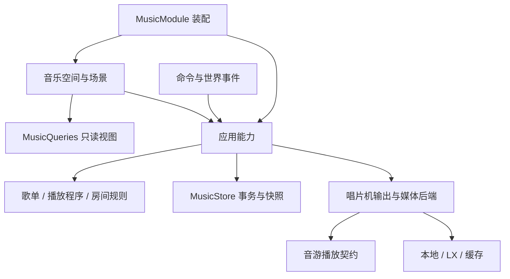

# 音乐功能架构

代码位于 `feature/entertainment/music/`。玩家操作见[音乐与音游](music.md)，目录和配置见[音乐文件与配置](music-storage.md)，跨功能依赖遵循[项目架构](architecture.md)。

## 所有权

`MusicModule` 创建对象、连接能力并管理关闭顺序。地段授权由 `bootstrap` 注入，音乐不引用地段实现；页面不持有 `MusicStore` 或直接启动事务。

| 边界 | 责任 |
| --- | --- |
| `catalog`、`online` | 曲目身份、本地目录、在线来源、搜索、媒体缓存；解析地址与曲目身份分离 |
| `playlist` | 保存歌单、稳定条目与移动规则；不依赖 Bukkit、数据库或菜单 |
| `playback` | 程序快照、一次性请求、播放出现、模式与历史；不依赖 Bukkit 或后端 |
| `application/PlaylistService` | 作者鉴权、持久编辑、导入、收藏歌单、撤销与历史删除 |
| `application/MusicQueries` | 当前玩家的只读视图，过滤他人的私有内容 |
| `application/MusicDeviceRegistry` | 设备身份、个人记录、别名与使用授权，区分物理成员和逻辑目标 |
| `application/MusicGroupService` | 同步关系、组设置与恢复上下文的事务，提交后调整输出 |
| `application/MusicPlaybackController` | 播放编排、队列命令、输出与时钟、定位、听众去重和检查点 |
| `application/MusicRooms` | 单设备房间、控制者、准备、开局、结束和输出隔离；只发布不可变视图 |
| `application/MusicMainThread` | 后台完成后回主线程应用，关闭时结束待完成调用 |
| `jukebox` | 物理输出、声音设置、共享时钟、音频与 NBS 后端 |
| `rhythm` | 房间规则、玩法、谱面、判定、网络检测与校准；经播放契约使用后端 |
| `config` | 启动参数读取与校验 |
| `storage` | SQLite 事务、序列化与不可变快照 |
| `ui` | 浏览、播放目标和任务状态，声明控件并调用应用能力 |
| `command`、`listener` | 命令与世界事件适配、实体物品事务，复用应用规则 |

依赖通过构造器传入；`MusicPackageArchitectureTest` 检查依赖无环、纯模型边界和可变状态封装。

## 三种数据与三个生命周期

- 保存歌单由作者维护；`PlaybackProgram` 是提交时的播放快照；`QueueEntry` 是一次播放出现，同曲可重复。编辑歌单不改已提交程序。
- `DeviceId` 写入唱片机 PDC，坐标只用于定位。个人记录不代表所有权；现场发现、记录入口和每次控制共用身份、加载、距离及当前地段权限校验。创建与解散同步组在拓扑事务内同步个人组记录。
- 逻辑播放目标是一台设备或一个组，只推进一份程序；成员的完成通知不能重复推进下一首。
- `PlaybackAttempt` 拥有运行 ID、后端会话、歌词、收听计时与一次性统计；结束后旧回调失效，迟到资源立即释放。
- 设备输出维护位置、音量和范围。组成员共享时钟，可分别离线、失败或被音游占用；同曲播放不自动建立组关系。

实体唱片与数字程序独立：手动数字播放可清空唱片槽，实体唱片插入则暂停本地数字输出；自动续播避让实体唱片，失败保留物品。具体操作后果见[播放与队列](music.md#播放与队列)。

## 线程、事务和恢复

Bukkit 方块、玩家与运行状态在主线程读写；网络、媒体准备、文件、谱面分析和 SQLite 在后台。数据库由单写入执行器管理，提交成功才发布编辑快照，失败保留原快照。

命令携带对象、条目身份与预期版本。组拓扑事务核对成员、程序和组版本，保存恢复内容与进度后再调整输出；程序编辑同时核对组关系，阻止旧独立入口继续写入已入组设备。异步准备与自然推进还须核对运行身份。

`MusicSubmission` 固定作者、唯一目标、歌曲与插播或追加语义。持久化回执记录程序及指令代次，输出失败只重试输出；后续指令或快照变化可使旧回执失效。成员重试只补齐缺失输出，保持正常成员和共享时钟。回执随工作台释放，不跨重启保存。

存储按变更行写入带类型的快照。检查点约每 10 秒及关闭时捕获，重启后等待明确继续。损坏数据使存储保持不可用，不发布空状态覆盖存档。`MusicDataPaths` 和 `LxSourcePaths` 分别分配功能路径与音源路径，服务不自行拼接插件根目录。

启动先后台校验配置、按容量初始化缓存，再回主线程启用入口，异步加载数据库、曲库与来源。配置无效时保留文件且不启动运行任务；停用后的迟到结果不得注册入口。

关闭依次结束世界入口与界面、主线程完成回调、房间与游戏，保存检查点并停止输出，再释放曲库、媒体、歌词和来源，最后关闭存储与执行器。清理失败不阻止其他步骤。

## 界面状态

`MusicWorkspaceState` 分开维护集合浏览、设备筛选与目录位置、唯一播放目标、互斥辅助面板和任务结果。「播放设备」导航始终回到目录；管理检查器与播放目标相互独立，队列选择、移动与字段属于检查器对象，快捷切换播放目标保留这些状态。多选属于集合，`GroupDraft` 属于建组或加成员任务，不构成另一套播放范围。完成回调核对浏览修订、对象和任务票据，不能覆盖后来的导航、搜索或输入。

| 所有者 | 状态或资源 |
| --- | --- |
| `MusicWorkspace` | 工作台、各任务输入及完成回调 |
| `MusicWorkspaceComposition` | 通过共享组件组合导航、阅读区、辅助面板与播放条 |
| `MusicLibraryScenes`、`MusicTrackTable`、`MusicPlaylistTable` | 曲库和歌单投影、稳定行身份及元数据；渲染不触发探测或下载 |
| `MusicPlaylistPicker`、`MusicInputPanel` | 固定待保存歌曲、来源身份、浮窗草稿与 Dialog 字段输入 |
| `MusicPlayerControls`、`MusicPlayerComposition`、`MusicPlayerPanels` | 从一次快照生成状态、操作及局部播放设置 |
| `MusicDeviceScenes`、`MusicDeviceTable`、`MusicGroupScenes`、`MusicGroupContent` | 设备详情、选择、组成员草稿、原子成员卡片及移出/解散确认 |
| `MusicTaskEntries`、`MusicSourcePosition` | 导入历史、预览和分组来源的窗口，以及按来源键保持的阅读位置 |
| `MusicRhythmScenes`、`MusicRhythmComposition` | 房间选择与个人准备；浏览不创建房间或暂停输出 |
| `MusicQueueScenes`、`MusicQueueRows`、`MusicQueueTable` | 按出现身份及分区呈现待播，不把随机候选视作预测顺序 |
| `MusicPlaylistMoves`、`MusicMove` | 固定移动对象、版本与条目顺序；工作台同时只允许一个放置步骤 |

共享布局、搜索、表单、浮层和图标的调用以[空间菜单 API](spatial-menu-api.md)为准。音乐不另写布局、分页或输入超时规则。

歌单目录、保存目的地及导入合并列表使用共享窗口表格，功能传入不可变快照和自己的浏览页码；表头及单行模板决定列宽，测量只生成当前窗口。集合翻页回调核对浏览修订，保存浮窗关闭后拒绝旧操作和重绘。播放器属于工作台下方的辅助工具区，其布局由实际宿主分配约束。

曲目目录用同一窗口机制保留普通浏览、选择和移动三种状态。功能层声明单行曲名、内容宽度列和紧凑表示；共享窗口表格的 `.fitVisibleColumns()` 测量当前窗口，按实际字号分配列宽，不扫描完整曲库，也不让第一首歌决定后续名称的宽度。曲名按钮按文字自然尺寸布局，不设宽度下限、不拉伸、不预留空行。横向空间不足时改为通栏曲名、歌手／时长和图标动作；只有名称自身超过可用宽度时才截断，并在提示中先保留全文，再显示补充元数据。分页栏保留自身所需宽度，不拉宽单元格按钮。「选择本页」由实际测得的窗口构造。

设备目录在共享有界行数内完整测量方位列的需求，空间不足或条目更多时改用紧凑窗口；管理目录的两种布局均显示状态、位置及曲目；成员选择省略重复的类型与曲目信息。管理模式将「使用」与「管理」分为独立动作，选择浮窗与成员草稿仍通过名称选择目标或切换勾选。成员集合在构造时复制，测量不读取 Bukkit。设备快照与方位在主线程准备，目标浮窗结束后拒绝旧回调。

同步组编辑器将成员目录嵌入自身阅读区，不依赖被辅助面板遮住的浏览区。编辑期间收起曲库导航，播放栏仅保留输出选择，名称编辑与队列来源按需打开，保证大字号下仍有成员阅读空间。独立设备详情以正在查看的对象作为建组种子，名称预填；草稿保存取消时的返回面板。场景选取通过草稿的明确意图暂时关闭菜单，`MusicWorkspace.at` 发现设备后复核草稿身份、独立设备身份、权限与容量，记录设备后返回同一草稿，重复选择不会移除成员。普通世界点击继续打开对应设备的队列；重新打开工作台结束待选意图。新增成员与新建组共用此流程。

房间目录与成员名单传入完整、不可变的设备／玩家摘要，布局只生成实际窗口，表头持续保留；空间不足时使用保留完整提示的紧凑表示。`MusicSourcePosition` 保存来源键和索引，名单重排或字号变化后继续定位原对象；切换房间或任务时结束旧阅读范围。分页和动作核对所属面板、当前位置及前台会话，准备参数与选曲在执行时读取当前值。设备刷新检查覆盖实际来源中的目标，语言变化也会触发重绘。

导入历史、曲目预览和分组来源选择传入完整快照，由共享窗口决定实际容量；重复导入曲目使用独立的出现键。改名保留草稿、请求身份和阅读位置，切页只更新浏览状态，提交时核对任务及保存状态。同步组最多 16 个成员，每张卡片将名称、位置、传送和成员操作作为不可拆分的文档块，紧凑表示保留完整提示和操作身份；从成员音效设置返回时恢复成员书签。音乐界面已删除固定 3／5 项切片、手动分页辅助方法及失去调用的翻译键。

辅助面板及其内联表单使用任务独立的输入作用域，同一任务的草稿编辑保留作用域，结束任务、切换对象或详情分类时更换。同名控件因而不会将旧房间、设备或编辑任务的实体身份交给新对象；工作台的导航与阅读位置继续由原状态维护。

设备设置默认收起名称与个人别名，音量和主要操作持续显示。展开使用共享普通节点组合，功能持有当前展开视图，旧快照不能更改后续视图；同一任务刷新保留展开，切换设备或分类后重置。输入期间禁用收起并说明原因，避免折叠丢失草稿；字段提交仍核对当前面板、展开视图及应用层权限。

`EntryEdits.Destination` 表达稳定条目之前或列表末尾，不传位置下标。应用层鉴权并核对版本，领域模型保护当前曲、分区和随机模式；过期目标不退回其他位置，顺序不变的移动不生成版本或撤销记录。撤销显式绑定歌单或设备 ID。

队列显示为带分区标签的窗口表格，只有当前窗口生成条目控件。浏览操作核对检查器对象与程序版本；移动后保存出现 UUID，并在最新快照中查找索引，再由共享窗口按实际容量定位。切换检查器对象或详情分类结束旧定位，切换底部播放目标保留检查器；分页测量不修改选择、移动草稿或程序。

`MusicPlaybackSnapshot` 一次采样目标、出现身份、运行代次、状态和时钟；实体唱片使用 `PhysicalPlayback` 身份，不伪造队列条目。定位核对播放身份，同曲重播使旧请求失效，普通追加不单因版本增长使定位失效。准备取消另核对 `preparation` 批次，保留已提交队列；同步组优先呈现仍在播放的成员。

`MusicPlayerTimeline` 在主线程采样、合并两 tick 内的定位，绘制只读取缓存并有界推演；暂停、换目标、挂起和关闭取消待发定位。已知时长的进度更新不重测整页，未知时长文字按秒刷新。共享范围控件只处理数值与回调，音乐负责解析、鉴权和定位。

`MusicSoundEdits` 按玩家与目标合并数值意图，同一目标最多一笔声音写入在途；失败丢弃未提交意图并读取权威快照。退出清理本地队列，不撤销已提交事务；参数边界由声音模型统一维护。

`MusicDeviceLocation` 只投影方位与距离。`MusicDeviceLocator` 拥有固定颜色、短编号、标签和粒子，工作台以一个半秒主线程脉冲验证并标记最多四台附近设备；暂停、关闭、退出或停用清理。标签与粒子通过 `FloatingMenus.worldOverlayVisibility(player)` 等共享投影避让界面，不重复保存菜单几何。

`MusicDeviceTravel` 独占主动传送请求及安全落点查找。先经 `authorizeVisit` 校验记录和权限，再异步加载既有区块，回主线程复核设备、授权、碰撞、支撑、边界与高度后传送。每人至多一个请求，关闭或暂停宿主、退出与停用会取消；不放入播放控制器或渲染函数。

## 验证

验证命令见[构建与验证](../README.md#构建与验证)。关键边界为事务回滚、私有数据、版本冲突、一次性队列与循环、提交后输出失败、同步组授权及不加载区块。
