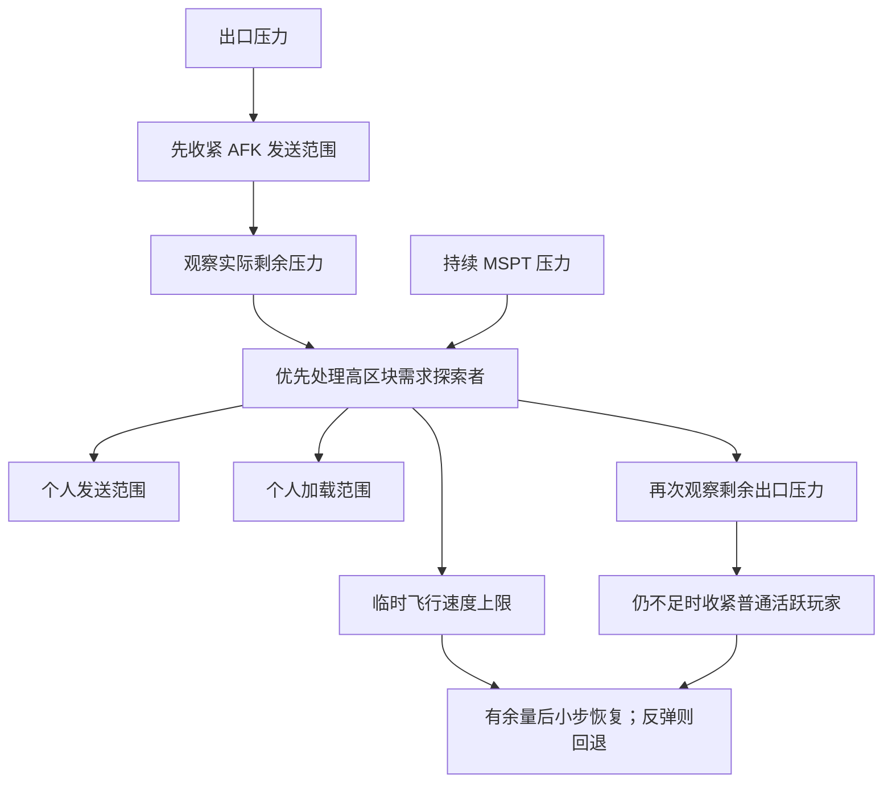

# 网络出口与自适应视距

网络出口模块使用默认路由网卡的实际发送字节数，对 **20 Mbps** 出口预算进行反馈调节。
拥塞时先降低 AFK 玩家的区块发送距离，观察带宽变化，再决定是否限制活跃玩家。
全局带宽控制器改变 Paper 的区块发送距离；个人跑图保护另外协调发送范围、加载范围与飞行速度。
世界配置、模拟距离和原有更低上限继续生效。



## 观测与反馈

每个采样周期先在后台读取 Linux 网卡计数器，再回到服务器主线程更新控制器和玩家视距。
前一次控制完成后才安排下一次采样，避免主线程卡顿时堆积旧决策。正常间隔为 20 tick，
流量计算、平滑和确认窗口均使用单调时间，不能把 tick 数当成真实秒数。

设采样间隔为 `dt` 秒、出口预算为 `B` 字节/秒：

```text
raw = (txBytesNow - txBytesPrevious) / dt / B
alpha(dt, tau) = 1 - exp(-dt / tau)
EWMA = previous + alpha * (raw - previous)
```

快、慢平滑窗口的时间常数分别为 2 秒与 10 秒。快窗口用于收紧，慢窗口参与恢复。
普通收紧同时要求原始压力仍然偏高，避免流量已经下降后被旧的平滑值继续压低视距。
持续满载另外累计原始压力确认时间，防止低流量历史让平滑窗口延误紧急保护。
恢复要求原始值、快窗口和慢窗口全部低于阈值。

网卡计数包含实体同步和同机其他进程的流量。20 Mbps 是控制预算，视距按实测反馈调节；
物理链路容量由运维配置。

## 限流顺序

| 条件 | 动作 |
| --- | --- |
| 原始、快窗口压力均达到 70% | 先把 AFK 发送半径比例收紧到 `2/32`，对所有合法原视距均得到 2 区块 |
| 存在发送距离超过 2 的 AFK 玩家 | 留出 5 秒观察 AFK 限流后的实际剩余压力 |
| 没有可削减的 AFK 发送范围 | 跳过这段等待，仍须连续确认 2 秒活跃玩家压力 |
| 原始、快窗口压力均达到 85%，确认满 2 秒且观察窗口结束 | 按剩余压力计算下一次活跃玩家限流 |
| 原始压力持续达到 98%，确认满 2 秒 | 缩短观察窗口；首次发现仍然只先处理 AFK |

已经识别到高区块需求的探索者时，在 AFK 观察完成后，再给个人跑图保护一次 10 秒窗口（包含 5 秒确认与 5 秒反馈），
仍不足才扩大到普通活跃玩家。这段等待每轮拥塞只发生一次，持续高速跑图不能无限推迟全局保护。
持续满载使用紧急窗口，不追加个人保护的等待。

每次收紧活跃玩家后重新观察 5 秒。持续满载可以继续使用 2 秒紧急窗口。
AFK 限流后压力回落到活跃玩家触发阈值以下，就不再收紧活跃玩家。

设活跃玩家当前保留的半径比例为 `r`，快窗口压力为 `p`：

```text
areaFactor = clamp(0.75 / p, 0.50, 0.90)
rNext = max(3 / 32, r * sqrt(areaFactor))
```

75% 是调整目标，85% 是再次收紧的阈值。平方根依据覆盖面积与半径的关系估算单次步幅，
后续调整使用新的实测压力。

每位玩家以原有有效发送距离为基准，包含客户端上限和已有的个人上限：

```text
target = max(min(original, floor), ceil(original * r))
floor = 活跃玩家 3 区块，AFK 玩家 2 区块
```

原有距离只有 2 区块时继续保持 2，不因最低保护距离而扩大范围。
相同比例作用于每位玩家自己的基准，避免低客户端视距的玩家完全不受调节、
高客户端视距的玩家承担全部削减。退出 AFK 时立即使用当前活跃玩家比例。

## 恢复试探与回退

原始、快窗口、慢窗口压力都连续低于 65% 满 15 秒，才允许一次恢复试探。
先恢复活跃玩家；活跃玩家比例恢复到 1 后，再逐步恢复 AFK 玩家。
每次最多增加原发送半径的 5 个百分点，并使用当前压力限制试探规模：

```text
rProbe = min(1, r + step, r * sqrt(0.75 / max(0.01, pressure)))
pressure = max(raw, fast, slow)
```

恢复步幅按当前压力与半径平方关系限制。每次试探保留原限制，观察 10 秒：

- 活跃玩家试探后再次满足 85% 的持续压力条件，回退到原限制。
- AFK 试探后原始、快窗口再次达到 70%，优先回退 AFK。
- 失败后恢复等待翻倍，最多 120 秒；步幅减半，最小为 1 个百分点。
- 试探成功后，等待和步幅分别逐渐返回 15 秒与 5 个百分点。

压力位于 65% 到 85% 时保持活跃玩家视距。

## 高速跑图与飞行联动

个人探索控制器每 20 tick 在主线程采样。只有持续达到 24 格/秒的高速移动，才会进入新的
个人保护的候选判定，且必须同时存在持续的实际资源压力；已受限的玩家继续跟踪，即使限速后低于该速度。
入服和传送后有 10 秒宽限，世界切换重新建立位置基线。

控制器使用三类观测：

- `PlayerChunkLoadEvent` 记录玩家实际收到的区块数量。事件里只计数，后续采样任务才调节状态。
- 按个人加载范围和客户端上限计算有效覆盖范围，同时保留模拟距离造成的加载需求。
  对移动前后的覆盖方形求差集，估算新增覆盖面积；斜向移动的重叠部分只计一次。
- 在移动方向的加载前缘之外最多探测 8 个点，仅调用 `isChunkLoaded`。未加载比例用于估计
  下一段路程的加载需求；探测本身不会加载或生成区块。

前缘估计表示个人路径将引入的未加载范围，包括从磁盘读取和新生成的区块。

网络与加载压力独立判断，分别使用出口实测值和服务端实际平均 MSPT：

| 资源 | 预算启用条件 | 繁忙时共享预算 |
| --- | --- | --- |
| 实际区块发送 | 出口压力达到 85%，且已经过 AFK 观察窗口 | 64 区块/秒，按 `clamp(0.75 / pressure, 0.5, 1)` 缩放 |
| 预测未加载覆盖 | 实际平均 MSPT 达到 45 ms | 24 区块/秒，按 `clamp(45 / mspt, 0.5, 1)` 缩放 |

只有对相应资源有需求的高速探索者才计入共享人数。预算先按人数分配，发送与加载
分别保留每人 8、4 区块/秒的基础预算，再应用繁忙系数。区块需求用于繁忙时分配负载，健康状态下解除对应预算。

需求以 3 秒时间常数平滑。原始需求仍高、平滑需求超过个人预算的 115%，且对应资源压力
连续出现 5 秒时才收紧，调节间隔至少 5 秒。压力中断会清空确认时间，间歇突发不能累计。
网络持续接近满载或 MSPT 达到 60 ms 时，确认与间隔缩短至 2 秒。
发送和加载独立计算，未繁忙资源的系数保持为 1，单次系数为：

```text
factor = clamp(0.85 / demandRatio, 0.5, 0.9)
radiusNext = max(0.25, radius * sqrt(factor))
flightCeilingNext = max(0.025, min(oldCeiling, abs(actualFlySpeed) * min(sendFactor, loadFactor)))
```

Bukkit 的 `0.1` 飞行速度对应 `/fly speed 1`；最低临时上限 `0.025` 对应 `0.25x`。
飞行速度按实际超预算程度减少，个人加载和发送范围分别保留至少原范围的 25%，
并遵守原有更低距离。发送范围与全局限制取更严格值，均以原始有效范围为基准，避免重复相乘。
仅发送压力不缩小加载范围；仅加载压力通过个人加载范围和飞行速度减负，不触发全服网络降距。

玩家选择的速度与临时实际速度分开维护。受限时 `/fly speed 10` 会保存 10x 请求，但实际速度
继续遵守临时上限；命令和首次限速会显示实际与请求速度。限制不取消飞行权限。
外部插件可见的速度修改会成为新基准，释放限制时不会覆盖后来的外部修改。
该速度上限控制原生自由飞行与 `/fly`；鞘翅、载具仍受个人区块范围限制，其物理速度不由
`setFlySpeed` 控制。

网络低于 75%、实际 MSPT 低于 40 ms 连续 5 秒后，开始恢复范围和速度；每次最多恢复
原始范围的 10 个百分点、Bukkit 飞行速度 0.1（1x）。恢复不要求区块发送量或预测加载量降低，
持续跑图不会阻止健康资源恢复。恢复后观察 10 秒，只有实际资源再次繁忙且重新超预算才回退，
并把后续等待翻倍，最多 120 秒。成功后逐渐缩短等待，最低 5 秒。

## 区块卸载与内存回收

玩家离开加载范围后，不再被其他玩家、模拟范围、插件票据或强制加载规则保留的区块，
由 Paper 自动保存并卸载。个人加载范围在实际性能压力下收小时，也会释放范围外的玩家加载需求；
其他来源仍然需要的区块继续保留。跑图控制器不为沿途区块添加插件票据，前缘探测也不会加载区块。

Paper 使用世界配置 `chunks.delay-chunk-unloads-by` 延迟卸载，当前默认值为 `10s`，
实际以服务器配置为准。缓冲结束后按 tick 分批卸载，减少短时折返引起的反复读盘。配置含义见 [Paper 世界配置](https://docs.papermc.io/paper/reference/world-configuration/)。

自动卸载释放旧区块内存并保留已保存地形；压力反馈控制新引入的需求。资源健康时保持原加载范围，
其他功能持有的加载票据继续有效。

## 采样中断与生命周期

计数器回退、网卡切换、读取失败都重新建立采样基线，不产生零流量样本。
超过 5 秒的采样区间或排队超过 5 秒的结果不提供收紧、恢复或试探成功的证据。
中断会清空确认窗口；短暂失去观测时保持已有限制。
连续 60 秒没有可用观测后解除全局网络限制，避免在无法监测的系统上永久保留旧网络覆盖值。
个人跑图保护仍按区块需求和 MSPT 的独立观测工作。
新鲜采样恢复后重新判断压力。

玩家加入、切换世界、改变客户端视距或 AFK 状态时重新计算个人限制，
另每 5 秒核对仍在限流的玩家。停用时取消后台采样、主线程控制和客户端选项刷新任务，
移除监听，并恢复仍由模块持有且没有被其他设置替换的发送、加载距离与飞行速度覆盖值。
个人探索采样独立于网卡读取，网络探测不可用时仍可依据区块需求和 MSPT 保护服务器。

## 诊断与验证

管理员执行 `/network status` 可查看当前阶段、网卡、原始流量、快慢压力、
保留半径比例、恢复等待时间、各世界的发送范围、MSPT 与受限探索者列表。细粒度调整使用 FINE 日志，
阶段变化使用 INFO 日志。

`NetworkEgressThrottlePolicyTest` 验证限流顺序、时间窗口、距离上下限和带反馈延迟的恢复过程。
采样与跑图测试验证资源独立触发、中断恢复、多探索者预算及外部设置变更。实服调节可结合
`/network status` 和日志观察实际流量与响应。
