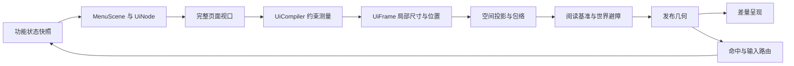

# 空间菜单架构

调用和参数见 [API](spatial-menu-api.md)，玩家操作见[空间菜单](spatial-menus.md)，图形含义见[图标规范](spatial-menu-icons.md)。本文说明共享层的职责、布局与动画。

## 职责与处理流程

功能维护业务状态、选择、查询、页码和草稿；共享菜单管理布局、空间呈现、输入与显示资源。跨功能入口放在 `shell/menu`，共享实现放在 `shared/menu`，依赖遵循[项目架构](architecture.md)。

主页面处理流程：

| 归属 | 职责 |
| --- | --- |
| 功能页面、`MenuPanel` | 读取一致快照，生成组件和动作；执行时复核权限、对象与版本 |
| `UiNode`、`UiKey`、`UiSceneContent` | 不可变内容树、稳定身份和内容位解析；保留声明槽位 |
| `UiCompiler`、`UiLayout` | 纯测量、约束分配、分页与局部位置校验 |
| `ComponentSceneLayout`、`SceneGeometry` | 空间投影、绘制包络、面板与输入几何 |
| `MenuPresentation`、附着控制器 | 先测父页并确定阅读参数，再独立测量浮层；阅读基准、世界适配、来源附着与避让 |
| `MenuPoseTransition`、`MenuLayoutMotion` | 当前姿态与目标的有限过渡、剩余路径包络及验证缓存；不修改组件测量或业务状态 |
| `MenuSharedElements` | 根据显式对象身份匹配导航两端，将上一已发布表面转换到新页面的局部姿态；不转交实体或动作 |
| `MenuVisualSnapshot`、`MenuExitVisuals` | 接管移除内容的最后绘制数据，按会话时钟有界退场；不保留节点、业务回调、输入或面板资源 |
| `MenuPressFeedback` | 会话时钟驱动的短暂按压来源与到期状态；不持有动作或显示资源 |
| `MenuMetadataState` | 按实体保存实际发送的有效缩放、字号、旋转和主题；逻辑内容不变时仍识别父级绘制参数变化，发送失败使旧发布记录失效 |
| `MenuFrameSampling`、`MenuNodeSurface` | 先采样来源、再验证附着与采样浮层，随后发布控件；当前不可变表面供绘制、命中、提示和附着复用 |
| `runtime/space` | 纯遮挡与模型变换几何、有界方块快照；方块与实体共用凸体检查 |
| `MenuEntityObstacles` | 主线程实体查询、可见性过滤与模型采样装配；每次放置共用障碍范围 |
| `MenuBodyObstacles`、`MenuDisplayObstacles`、`MenuArmorStandObstacles` | 普通实体、展示实体与盔甲架的模型元数据适配；不接管菜单布局、输入或业务状态 |
| `FloatingMenuService` | 会话、导航、输入消费、动画采样及显示资源清理 |

组件构造和测量不查询仓库、不分配实体、不执行动作。卡片、工具栏、表格和检查器优先组合现有节点；新增核心规则须有多个场景需要，或能证明现有模型无法表达。

`FloatingMenuScreen` 的渲染标识必须匹配注册的导航所有者；同一屏幕切换业务对象时，将对象 UUID 保留在内容路径中，使旧对象的实体与动作身份失效。PVP 设置、地段时间／天气及传送点详情／标题页遵循这一分工，空态和失权态沿用所属屏幕的导航标识。

主菜单中心入口使用通用的 `UiLayouts.balancedGrid`，以实际图标、标签和换行后的网格宽高选择列数。宿主声明最多三列、目标宽高比 1:1、等价形状优先竖向。入口使用等宽列、等高行，并填满所属单元格，使同组控件的左右边界和上下边界对齐。单元格宽、高按内容分别测量，图标比例和文字字号保持；显式最大尺寸仍被遵守。整体形状在内容可读、入口可访问的前提下接近方形。

`UiPagedLayout` 为普通布局提供有界分页，复用同一个布局方法测量连续前缀和发布页面；网格、换行、纵列均可接入。现有分页规则统一扣除页脚，再按最大可容纳前缀确定容量，各页保留最大实际正文外框；尾页按自身内容重新布局。只处理尺寸溢出，重复身份和无效布局继续报告。大型集合使用窗口列表／网格，避免构造、测量全部屏外条目。

主菜单通过 `shell/menu/MainMenuLayout` 给中央入口和两侧组件分配有限空间。左右列共享对称的宽度预算并垂直居中，组件内容变化不会将中央入口横向推偏。`MainMenuSidebar` 为左右两侧组装有序的组件列表，各自保留分页位置，超出当前高度时分页。每个组件声明稳定标识、`MenuPanel` 和可选的状态变更标记；静态内容或主动回调重绘的组件无需轮询标记。两侧复用宽度上限、间距与面板样式，各组件按自身内容测量，空组件不保留背景或间距。每列声明一个透明侧向平面，卡片继承整列朝向；下方卡片不会因高度变化被自动归为底部工具面板。主菜单会话转交挂载与暂停／恢复通知，关闭时释放全部组件，即使个别清理失败也继续释放其余组件。新增组件只需加入对应列表，不修改中心入口布局或刷新聚合规则。

公告通过 `AnnouncementHighlights` 提供缓存预览与版本标记，阅读器按实际空间拆分完整正文，目录浏览与正文位置分开维护。地段通过 `noticePanel` 提供当前位置的公告，`PlotNoticeContent` 为 `PlotNoticeReader` 浮窗与 `PlotNoticeMenus` 独立页提供同一份阅读内容，各自会话持有位置。浮窗来源绑定地段 ID，父页重绘时读取当前内存快照，来源消失后关闭并使旧翻页回调失效。主菜单只聚合两侧内容与中心入口，不读取公告文件或管理阅读状态。

治理功能在 `GovernanceVoteDetails` 集中声明完整投票详情，治理事项页与活动组件的投票浮窗直接复用。组件接收请求者的投票快照、交付状态与交互状态，统一生成字段、样式及投票控件；宿主提供提交回调，分别管理查询、错误反馈与关闭，不构造另一套详情内容。

## 布局约束

- `UiSizing` 声明组件最小、最大尺寸；`LinearSlot`、`GridSlot` 声明父级分配。固定尺寸由相等的边界表达，自然尺寸来自测量。
- 父级传入有限约束，先确定列宽或交叉轴，再按最终宽度重测换行和行高。无效尺寸、冲突跨度与越界结果报告组件路径。
- 空槽位保留身份；零尺寸容器不制造背景和间距。固定占位和画布按声明保留。背景随当前内容双向调整，不保存历史最大尺寸。
- 网格与表格共用跨度校验、最终测量和定位；表格列宽由轨道分配决定。内容、比例列保留控件实际下限，不能用缩小文字掩盖空间不足。
- 分页保留标题与操作高度；页脚变化的重测限制在集合内部，最多八轮。标题／正文的局部宽度重测也最多八轮，不形成跨面板约束循环。
- 身份绑定实际对象，不绑定排序序号或页码。翻页、筛选和重排不改变已开始操作的对象。

等高长集合由 `UiWindowedList` 先测量不发布的行模板，再用标题、页脚和有限高度确定窗口；最多创建当前窗口的 256 项，不扫描其余集合。`UiWindowedTable` 复用同一窗口规则，由表头与行模板确定共用列宽，治理人员目录及音乐歌单、曲目、队列、保存目的地与导入合并列表已接入；单行标签保留完整提示。模板与条目共用当前文字倍率，超高条目显式报告溢出。多页保留分配宽度和完整正文高度，标题持续显示；变高段落沿用完整测量的有界分页。查询、选择和浏览状态仍由功能维护。`UiWindowedGrid` 复用同一窗口，将卡片按实际列宽和完整行分页；地段及成员目录已接入双行与单行回退，卡片可附独立的次要操作。

窗口条目与页脚工厂只读取快照。`observeWindow` 将数据身份和最终页范围随 `UiFrame` 发布，`MenuWindowObserver` 在运行时 tick 的呈现提交后阶段去重交付；编译与布局失败没有副作用，暂停清除交付记录，恢复重新通知。每次回调后复核当前会话与帧身份，重入替换立即停止旧帧通知。功能根据范围安排自己的有界工作，世界查询不进入测量工厂。

`UiDocument` 对有界正文按最终宽高拆分纯文字段落，图文和交互组保持整体，超大组使用显式回退。阅读位置使用源块键和码点偏移，重排后寻找包含原位置的页面，不沿用旧页码。家列表也按实际行高分页，以家名保持浏览参照；翻页保留选中的传送目标，改变查询才重置筛选位置。测量仅发布当前页的显示与动作，不写回功能状态。既有内容位可通过 `UiDocumentPort` 复用相同段落拆分与源位置规则；地段工作区概况通过该适配接入，传送点介绍直接声明类型化正文。

换行文字先按宿主宽度与实际字号确定可用行宽，再扫描内容；长文片段与页脚重测不再逐次缩窄行宽、重复扫描同一段落。Unicode 字素边界按原字符串索引读取，保留组合字符与样式。视图内的文字尺寸及全文换行缓存继续共用容量与权重上限，不保留动作或屏外显示实体。

具体默认值、自定义布局协议与溢出回退见 [API](spatial-menu-api.md#容器与表格)。

## 空间呈现

二维布局先产生局部矩形，再安排刚性面板、模型包络与层级变换。背景、文字、图片、模型、命中和避让使用同一份最终姿态；动画中的视觉副本不拥有业务动作。

主阅读区由布局焦点确定。普通卡片继承所在平面；`sidebar` 显式声明水平内收，`toolbar` 显式声明垂直倾斜。`split` 由组合声明首选轴，只在完整内容放不下时换向，并同时发布相应朝向；侧栏高度或工具宽度变化不再触发位置猜测。纵向组合先预留导航，再分配当前正文的有限高度。自由面板仍可声明自动朝向。深度用于表达阅读区、工具与临时层的关系，正文和高频按钮保持稳定。

普通前方页面（`IN_FRONT`、`FRONT_ARC`）在组件测量前通过 `MenuViewportLayout` 分配完整页面视口。普通页面的绘制范围以宽 6 格、高 3 格为上限，默认空间比例为 0.25；按 `WORLD_PER_UI = 0.02` 换算，默认最多 1200×600 UI。世界绘制范围由 `MenuScene.DEFAULT_VIEWPORT` 与默认空间比例推导，调整默认体量时保持逻辑容量一致。声明视口仍可进一步限制尺寸。菜单倍率改变组件可用的逻辑空间，字体倍率参与真实测量、换行和分页；侧栏、标题及工具与正文共同服从父级约束。世界碰撞留白与场景外标题不属于绘制视口，仍计入完整空间包络。

偏好存档保存玩家最新请求，当前会话只持有一份已采用的 `FloatingMenuPreferences`。更新先捕获请求快照，用同组参数完成布局和空间准备，再采用新偏好；重测失败时保留上一份完整页面与观看基准。菜单大小、字号、FOV、主题及减弱动态不再分别写入会话字段。

原生显示实体的逻辑内容与实际绘制参数分别比较。背景尺寸即使没有变化，父级缩放、避障收缩或局部旋转变化后仍需重发变换；文字、按钮表面和物品模型按同组当前参数发布，标题、图标、范围控件及图片替代文字复用有效绘制上下文。只有元数据发送完成后才记录已发布状态；发送中断后整组重新同步，恢复旧参数也不能复用可能已被部分覆盖的记录。单纯位置移动继续只更新位置，世界锚定内容保留自己的单位。

`UiLayouts.contentRow` 与 `contentColumn` 共用按轴测量的实现：先预留常驻区域，将剩余宽度或高度交给指定正文，再按实际占用尺寸安排整页。设置分类切换后，侧栏与当前正文的实际尺寸共同决定居中范围。显式尺寸和画布继续保留声明的空间，普通 flex 仍用于需要填满的布局。`workspace` 使用横向规则，`sheet`、共享表单、语言目录、界面设置和主菜单入口使用纵向规则。表单先预留确认、取消与反馈，再分配当前字段；摘要限制行数时保留完整提示，长正文使用文档分页。主菜单侧栏与设置分类目录分别分页，浏览页码由宿主持有。分页测量统一预留首页、中间页和末页的工具高度，正文容量不随边界按钮或末页动作出现而变化。

音乐工作台同时呈现导航、当前主任务和常驻播放器。打开设备、导入或编辑任务后，由任务接替曲库所在的主区域；关闭任务后恢复曲库的查询、选择与浏览状态。隐藏内容停止发布动作，所属表单和聊天输入按可见性结束，避免两个完整阅读页面争用高度。主菜单侧栏、设置目录和地段矩形列表分别维护浏览位置，不借用业务选择或固定每页数量；矩形列表按实际行高窗口化，字号变化后仍定位原来源；翻页只改变浏览位置，保留已选矩形与地图视角。

`UiFocusLayout` 和 `UiFrame.readingRegion()` 只表达主阅读内容、排版焦点及附着来源，不再拥有另一套尺寸预算。普通页面以完整布局的中心投影到世界；主菜单通过对称侧栏约束保持中央区域稳定。`UiCompiler` 只接受宿主传入的有限约束，完整页面不足时由其上层组合换行、减少列数或分页。

默认 70° 的名义观看距离为 2.8 格。窄 FOV 按完整页面高度增加距离，使同一世界尺寸可进入视野；高 FOV 不放大页面或字体。完整包络仍约束最终阅读范围，特殊空间变换和世界障碍可进一步适配，但不回写逻辑视口或分页。空间避障将整页尺寸、模型深度及相对视点的位置按同一比例收缩，保持视野中的角大小；恢复也沿同一视点射线逐步放大，不设置固定物理距离下限。首次展示、加载页和详情浮层共用这一规则。视点位于不透明体内部、区块不可用或采样无法完成时，保留会话、草稿和观看基准，仅暂停无法验证的显示与命中，继续自动复核，不提示空间不足或关闭菜单。环绕及前方弧形保留各自的径向投影规则。

Popover 在父页确定实际阅读距离与比例后独立测量和定位，不扩大父页包络。父页、浮层测量与附着共用实际比例与名义比例，浮层使用同一完整视口上限；世界避障收近时保留其逻辑容量，不把临时收缩当作新的排版标定。Tooltip 是只读说明；可交互详情和确认使用 Popover 或完整子页。透明背景保留原有输入与避让边界。

放置检查覆盖完整阅读面到视点之间的体积，以及旋转、缩放后的模型包络。实体默认参与采样，不按生物／载具等父类维护可见实体清单；不可见控制实体（`Marker`、`Interaction`）和纯特效（药水区域云、闪电）排除。原版坐垫、末影水晶、掉落物、下落方块、TNT、投射物及经验球均可按模型参与，不依赖物理碰撞。首次发布使用已验证的位置，固定页面也会周期复核移动实体；恢复空间时逐步回到保留的阅读基准。完全没有安全位置时暂时撤下显示与命中，保留会话、草稿及业务操作，障碍移开后重新测量并恢复。

`MenuEntityObstacles` 只查询已加载实体、核对玩家可见性并装配快照。展示实体和盔甲架单独查询，覆盖模型伸到观察者附近、实体原点仍在查询范围外的情况；普通实体查询为动画与细长模型预留余量，最终仍按实际阅读范围筛选。模型适配器读取元数据，`MenuModelGeometry` 将局部包络变成统一的视点相对凸体，`MenuOcclusionGeometry` 只处理几何，不认识实体类型。采样不保留实体引用，不新增任务、线程或跨会话缓存。

文字展示复用默认字体的换行测量，独立判断文字与背景透明度，再应用展示变换与当前摄像机的公告牌朝向；退化为可见平面的模型仍参与采样。盔甲架的木架、装备和手持物按各部位姿态、大小与缩放估算，隐形空架不阻挡，标记状态不抹掉可见模型。普通隐形生物携带装备时采用实体包围盒。掉落物与末影水晶的动画、TNT 膨胀使用周期包络，三叉戟保留长杆朝向，避免只检查较小的物理碰撞盒。服务器无法取得客户端资源包的完整字体和物品网格，自定义模型边界仍是估计。

## 世界固定面板

菜单内容与放置方式分别建模。普通页面由 `MenuPresentation` 根据玩家视角建立阅读基准；世界面板由 `WorldMenuSurface` 提供世界坐标、完整旋转、物理宽高、显示密度和操作距离。墙面、地面、顶面或独立支架只是不同的表面参数，不引入另一套按钮、分页、射线或实体管理。

| 边界 | 归属 |
| --- | --- |
| 找到挂点、判断支撑与业务可用性 | 功能 |
| 固定坐标、朝向和物理范围 | `WorldMenuSurface` |
| 功能持有的展示能力 | `WorldMenuScope` |
| 槽位所有权、索引、数量与预算、作用域清理 | `MenuWorldPanels` |
| 测量、组件、显示、提示和输入 | 既有菜单运行时 |

物理范围换算为有限逻辑视口，使用相同的 `UiCompiler` 和 `SceneGeometry`。宿主的视口与可用实体容量独立于加载占位：保留已展示内容时，仍以当前表面的约束重测，缩小表面不会复用超出新范围的旧排版。测量和容量检查均通过后才提交保留内容；被拒绝的更新不会成为后续加载的来源。FOV 和菜单大小偏好不改变挂点或物理尺寸；字号变化在同一范围内重新排版、减少列数或分页，主题和减弱动态继续生效。新内容、表面和几何先完整准备，再替换当前呈现。表面中心代表背板平面，运行时只为内容厚度和动画策略声明的后退位移预留正面间距；平面模式的文字不额外离开背板，三维模型仍保留厚度。挂点使用实际几何表面的后沿，视野包络的避障扩边不计入贴面间距。父级完整旋转同时用于内容位置、显示变换与命中。

同一玩家可看到多个固定面板，每个功能作用域中的稳定键标识一个展示槽位。共享层只将输入交给最近的正面、可见、可用表面；间隙与不可操作内容也属于该表面的保护范围。操作前再次判断功能提供的可用条件，传送、权限等业务动作仍自行复核。实体包和普通世界事件共用玩家输入门，避免一次点击执行两次。

普通页面持有前台优先权，打开前先撤下固定面板的显示与命中，关闭后自动恢复；固定面板的内容状态继续保留。固定面板不加入前台返回栈，`openChild` 打开普通页面，返回后恢复原面板。固定面板使用平面内容树，标题放在树内；交互详情、表单等通过普通子页承载，避免浮层越出挂点的有限范围。

`MenuWorldPanels` 只维护一份「玩家 → 功能作用域与稳定键 → 会话」所有权索引，句柄查询、清理和预算均从此取得展示；渲染会话只持有表面与来源条件。清空展示释放当前会话，保留功能作用域；关闭作用域或服务则永久撤销对应能力。单个显示资源释放失败时，继续释放其余实体、注解和槽位，再统一报告失败。作用域由 `bootstrap` 创建并随功能关闭，玩家离线、换世界、死亡或重生时释放对应展示。离开显示距离或挂点区块未加载时暂停呈现。每位玩家最多保留 8 个固定面板，合计共享 `MenuEntityBudget` 定义的 2048 个实体预算，退出副本也计入；前台页面与固定面板不会同时占用显示预算。铁电梯通过 `PanelPlacement` 维护墙面／平台边缘搜索，通过 `View` 将楼层状态快照与书签映射为组件，复用共享网格与分页，不维护独立显示器和输入监听器。

## 输入与生命周期

组件语义与当前指针能力分别维护。`UiInput.interactive()` 保留控件的测量与组合语义，`UiPointerBehavior` 则从实际动作、可用状态、提示和焦点观察推导当前能力；`UiInput` 与 `MenuScene.Entry` 共用这一规则。组件角色、按钮外观或完整文字提示不能独自授予操作反馈。

| 当前能力 | 条件 | 指向后的表现 |
| --- | --- | --- |
| `NONE` | 没有动作、提示或焦点观察 | 静态呈现，不参与指针选取 |
| `INSPECT` | 只读提示、焦点观察，或暂不可用的动作 | 可以阅读说明；不高亮、位移、播放悬浮音或生成点击辅助实体 |
| `OPERATE` | 当前可用且已绑定实际动作 | 提供操作高亮、指向／按压反馈、提示音与点击辅助实体 |

运行时保存实际指向 `pointedId`，操作状态由 `MenuNodeFeedback` 单独推导。只读提示不会将节点变成按钮；省略姓名、资料、时间和读数仍可查看完整文字。禁用控件保持禁用外观并安静显示原因，不执行焦点回调。动作移除、禁用或同键内容替换时重新计算能力并清理旧按压与拾取资源，持久选择状态独立保留。

- 实际指向、逻辑焦点、数据选择和阅读保持分别维护。转头与悬停只产生反馈，保存、删除、播放和传送须显式执行。
- 输入按已发布几何确定作用域和目标，单次消费；关闭浮层或回调内重排不会将同一次点击交给新页面或世界。列表边界消费滚轮，数值控件自身调整优先。
- 草稿、预览和已保存值分开。取消不写回过时基准；冲突和失败保留输入，由功能提供重试、重新确认或合并。
- 较长表单通过有界字段目录浏览当前控件，再用 Dialog 编辑字段草稿；浏览与输入目标分开，清空绑定明确字段，表单确认和取消持续可见。名牌的前缀、后缀通过普通表单同时展示，确认和取消保留在常驻工具区；搜索使用单次聊天提交，名牌使用持续聊天预览。输入不设超时，结束条件由所属会话明确控制。
- 集合排版与分组导航分别声明意图。语言目录使用按实际尺寸选择列数的均衡网格，优先整页展示，整体接近方形；聊天、PVP、传送、主题颜色编辑与账号操作采用纵向列表。界面与文字使用同页表单，大小、字号、主题和动态选项同时可见；短选项按可用宽度换行，说明通过提示提供，不维护分组 Tab 或主页面码。聊天通过 `navigationAxis` 复用通用 `split`，优先将分组放在当前控件上方；名牌前后缀直接同页展示。带标题的正文复用 `reading` 骨架，先预留标题等常驻区域，再分配正文容量。宿主只提供完整页面预算，不按页面身份改写子树或另外推算宽度。
- 聊天设置持有浏览分组及页码，切换分组不写入偏好。语言目录、PVP、传送、颜色编辑与 FOV 选项保留独立页码。数值调整基于最新偏好，颜色与 FOV 的原生草稿只在所属页面有效时提交一次；切页、暂停与关闭撤销已失效回调。
- 异步结果核对页面、对象和请求版本；关闭后不重开页面，暂停页不抢前台。已提交的业务操作与界面是否仍打开分别处理。
- 任务、原生动作注册、提示、图片和虚拟实体有明确所有者。关闭、换世界、退出与功能停用统一释放，清理不依赖动画完成。

批量操作由功能捕获目标快照、逐项鉴权并报告部分失败；共享菜单不拥有全局选择或通用业务回滚。

## 内容与后端边界

文字、图标、物品、图片和范围控件共用组件、约束与输入。内容类型不改变动作身份；图形和动画帧不决定业务状态。

- 文字测量是服务端估计，需考虑富文本、字号和语言；自定义字体的实际字形可能与估计不同。
- 图片使用 Axiom 临时注解，由客户端下载；无对应通道时显示替代文字。服务器不知道下载结果，也未提供通用裁剪或动态图服务。
- 原版物品、方块没有独立材质透明度。模糊、任意遮罩、非等比模型变换等能力不能作为默认后端承诺。
- 当前维护统一空间菜单，没有基岩版专用表单或 DDUI。Geyser 的玩家识别与菜单呈现分开。
- 世界读写和耗时工作遵循[线程边界](architecture.md#数据与线程边界)；结构、测量和实体限制见 [API 预算](spatial-menu-api.md#预算)。

## 当前能力与限制

| 能力 | 当前边界 |
| --- | --- |
| 组合与布局 | 行列、网格、表格、换行、基线与短行内单元、叠层、画布、自定义有界算法；分页、源位置文档阅读与滚轮 |
| 空间关系 | 阅读焦点、独立面板、前方弧形和环绕、层级刚性变换与模型占位；统一地形／实体避障与空间不足时的显示恢复 |
| 状态与样式 | 共享主题、自定义配色、背景与内容透明度、选中及禁用原因 |
| 浮层与编辑 | 单个 Popover、只读 Tooltip、表单草稿、查询与对象选择器 |
| 动态与工具 | 可中断的进入退出、指向按压、局部布局过渡、退出绘制副本与显式共享元素导航；有限装饰、侧边跟随工具条及减弱动态 |
| 生命周期 | 导航恢复、请求失效、输入单次消费、差量绘制和所属资源清理 |

主菜单与设置、家、名牌、公告、治理、音乐、地段和载具复用这些能力；具体操作由各功能手册维护。垃圾箱保留原生物品界面，电梯保留贴墙的世界面板。

## 组件组合约定

`UiNode` 负责声明内容，`UiTemplates` 组合常用布局，`MenuPanel` 托管功能内容及其资源。组件的状态、布局与跨宿主复用遵守以下约定，后续扩展沿用相同边界。

### 复用层次与所有权

| 层次 | 应维护的内容 | 扩展方式 |
| --- | --- | --- |
| 基础节点与布局 | 内容、交互语义、尺寸、主题角色、局部几何 | 只有无法通过组合表达的测量或输入规则才进入核心节点 |
| 组合组件 | 卡片、字段组、状态区、列表条目、工具组、详情区的结构 | 接收快照和回调，生成普通节点；不自行查询或开启任务 |
| 功能面板 | 对象查询、草稿、请求版本、业务动作与所属资源 | 留在功能包，以 `MenuPanel` 提供给独立页、侧栏或浮窗 |
| 宿主 | 可用约束、页面导航、挂载、暂停／恢复与释放 | `shell` 聚合跨功能入口，功能页面聚合自己的面板；不复制被嵌入内容的状态 |

先在实际页面中验证组合，再提取多处共用的结构。功能专有的投票详情、音乐条目或地段权限编辑仍由功能维护；共享层只提取其中可独立说明的布局与交互规则。新增组件须说明使用场景、输入输出、状态归属、窄处回退和资源成本。

### 身份、状态与动作契约

稳定键用于连接同一对象的内容、输入和过渡。键的作用域仍是所属组件路径；同一业务对象出现在两个位置时拥有两份展示身份，跨宿主的视觉衔接另行显式配对。组件重排、刷新或换页不得把旧动作绑定到占据原位置的新对象。

| 状态或数据 | 所有者与表现要求 |
| --- | --- |
| 指向、按压、逻辑焦点 | 运行时维护短暂反馈；目标移除后重新确定命中或清除焦点，不自动执行相邻项 |
| 选择、查询、展开与浏览位置 | 功能维护任务状态；组件只呈现快照并请求变更，隐藏项的选择是否保留由功能明确 |
| 草稿、预览、已保存值 | 功能或所属输入会话维护；刷新和动画不能把预览当作已保存结果 |
| 可用性与进行中状态 | 功能提供实际原因、任务阶段和可执行动作；进行中是否允许重入、取消或继续浏览须明确 |
| 加载、空结果、错误与部分结果 | 使用有区别的内容和恢复入口；刷新失败可保留仍有效的旧内容，并标明其状态 |

进行中状态与选中、禁用分开表达。例如保存期间可以继续浏览，而重复提交暂不可用；取消请求只有业务支持时才提供。进度和数量接收真实数值，单位与文案由 Fluent 组织，未知进度使用阶段说明。动画结束不代表保存成功，静态状态也须能说明当前结果。

组合组件声明标题、正文、辅助说明、状态与操作的位置；只提供当前场景需要的部分。可见标签说明动作及对象，Tooltip 补充限制或完整短字段，长文进入阅读页。主动作、局部次要动作与高代价确认沿用统一规则；若条目本身可点击，内部工具须有独立命中区域，一次点击只执行一个动作。

### 测量与内容流

组件只声明逻辑尺寸和自身下限，宿主给出有限约束。优先保留可读字号与主要动作，通过换行、减少列数、纵向堆叠或分页适配。标题、详情与状态先完整参与整页测量，不能因为声明摘要行数就提前截断；仅当完整排版溢出时，编译器才对放不下的局部区域启用摘要，复用其余全文区域，必要时再向共同容器回退。内容与背景使用同一结果，所有测量共用预算，只有成功结果发布页码与动作；恢复空间后自动重新展开。缩短的内容保留悬浮全文，操作说明与禁用原因不覆盖全文，超长正文另有阅读入口。固定行高的输入框与虚拟窗口行保留明确的行数契约。

图文与文档流遵守以下约定：

- **基线。** 文字测量提供可选首行、末行基线，内边距及最小占位同步传递对齐线；图标、图片和模型无基线时显式回退到边缘或中心。行高包含上伸、下伸与图形包络，标签不会与相邻行重叠。当前字体垂直标定仍是服务端估计。
- **短行内内容。** 图标、头像、短读数与文字片段作为有界单元按顺序换行，各行共用基线。行内单元不使用 flex 权重；长标题、多段正文和三维预览继续使用块级组件，可交互片段保留独立身份。
- **分页分组。** 普通子树作为不可分条目参与分页；`UiAlternative` 为整组提供显式尺寸回退，只发布选中的同键表示。分页在扣除页脚后重新测量条目，并固定正文高度，避免回退组在最终定位时重新展开。`UiDocument` 支持纯文字长段落拆分、源位置保持，以及将正文声明为阅读焦点的模式；后者根据实际页码发布辅助操作，治理投票详情只在正文末页显示投票控件。
- **资源占位。** 图片使用已知尺寸或显式比例；替代文字也参与测量。不能依据服务器不可知的客户端下载状态改变布局。加载占位与空内容分开，零尺寸内容沿用不保留背景和间距的规则。
- **失效范围。** 先区分只更新绘制、需要重测子树、需要重新分页的变化。安全文字节点的尺寸、拟合结果与基线已按视图有界复用，键包含内容、字体样式、字号、约束与交互占位；动作、权限、选中和禁用说明仍按最新快照更新。动态对象、富文本交互载荷和超出权重上限的内容不进入缓存。

分页表格在同一所有者内收集全部有界行的列需求，再用统一列宽测量持续表头与当前数据页；表头先预留高度，数据页使用宿主剩余空间。变高行整体分页，超大行请求显式回退。共享列宽限定在同一表格内；当前不提供跨任意面板的共享轨道或大量变高数据窗口。

### 常用组合

| 组合 | 组合约定 | 代表场景 |
| --- | --- | --- |
| 条目与详情 | 选择、主动作、局部工具分开；详情绑定稳定对象，返回保留浏览参照 | 家、曲库、治理目录 |
| 字段与反馈 | 标签、草稿、错误、保存阶段相邻；窄处整组堆叠，失败保留输入 | 设置、名牌、地段表单 |
| 状态与恢复 | 首屏加载、后台刷新、空结果、失败、部分完成分别表达；重试核对当前请求 | 搜索、在线曲库、批量操作 |
| 阅读内容 | 标题、段落、插图、图注与全文入口按内容分页；刷新尽量保持正在阅读的段落 | 公告、地段公告板 |
| 任务工具与详情浮窗 | 工具属于当前任务；局部确认与关闭范围明确，来源消失后释放 | 地段编辑、载具编辑、投票详情 |

受控展开用 `UiTemplates.disclosure` 组合普通节点实现：摘要与开关保持稳定路径，正文只在展开快照中构建，折叠时不发布动作或占位。音乐设备将名称和个人别名放入此组，音量与主要操作持续显示；输入期间禁止折叠并说明原因，保留当前草稿。功能保存展开视图身份，拒绝旧回调，切换任务后重置。相邻控件复用已有布局过渡，快速反向从当前姿态衔接；折叠移除的浮层来源先结束资源，再停止读取内容。

其他组合继续复用现有节点和输入会话。共享组合不持有全局选择、业务撤销栈或保存队列。

## 动画设计方向

`FloatingMenuAnimation` 提供策略，`runtime/motion/MenuTransition` 按会话时钟管理有限属性过渡，`MenuPoseTransition` 处理局部姿态。局部进入、指向与按压的深度距离分别由 `entryOffset`、`hoverOffset`、`pressOffset` 定义，采样与固定面板的间距计算共用这些参数。`PLANAR` 预设将深度位移归零，保留透明度和布局过渡；背景由独立的外观与节点样式控制。进入退出、指向按压、内容出现和普通布局更新均从当前采样值衔接最新目标；图文与背景使用相同的布局时长与缓动。退出绘制由 `MenuExitVisuals` 托管，导航共享元素由页面显式声明。

### 动画用途与默认行为

动画表达操作反馈、对象连续性和层级关系。正文、主要按钮与阅读基准保持稳定；跟随、避障和内容变化分别计算，避免同一位移被多套策略叠加。

| 类型 | 设计要求 | 减弱动态时 |
| --- | --- | --- |
| 指向与按压 | 在原命中区域附近提供短反馈；不改变排版，不等待效果结束才执行动作 | 保留主题状态变化，取消位移与回弹 |
| 进入与退出 | 使用受限深度变化及后端支持的显隐；文字保持阅读方向，必要操作优先可见 | 直接进入稳定姿态，保留必要显隐 |
| 展开、折叠与重排 | 保留触发器和对象身份，相邻项过渡到新位置；再次操作可反向衔接 | 立即采用新布局，保留展开状态与焦点 |
| 局部内容更新 | 有效旧内容可保留至新快照就绪；只过渡变化区域，连续读数直接更新 | 直接更新文字、数值和状态 |
| 共享元素与导航 | 显式匹配同一对象的来源与目标，帮助识别列表到详情等关系 | 保留目的页、返回关系和对象选择 |
| 持续状态与装饰 | 只在真实活动且前台可见时运行；遵守现有图标动画名额，普通正文不循环运动 | 使用能区分实际状态的静态形态 |

当前进入、退出、按压默认分别为 6、4、3 tick，定义见 [`FloatingMenuAnimation`](../src/main/java/org/encinet/mik/shared/menu/FloatingMenuAnimation.java)。新增过渡使用共享的时长、缓动和距离策略，按用途与距离调整；这些默认值不作为所有组件的统一时长。实际运动受客户端插值与服务器采样共同影响。

短暂按压状态由 `MenuPressFeedback` 按会话 tick 到期，重复绘制同一 tick 不缩短持续时间；新按压替换来源与开始时刻。到期先清除语义状态并更新过渡目标，再交给通过空间检查的帧发布。遮挡期间继续计时，关闭、挂起、来源移除或禁用时清理反馈；计时本身不发送显示包。已删除按绘制次数递减的计数和恒定的按压状态缓存。

### 目标、采样与中断

布局计算最新快照的终态；动画只保存从当前呈现状态到终态的有限过渡，不把中间帧送回分页和约束测量。控件、浮层及导航配对使用以下采样和发布关系：

每个过渡至少记录所属会话与目标版本、展示身份、当前值、目标值、开始时刻、持续时间和插值策略。平移、旋转、等比缩放及可用透明度分别受后端能力限制；交互状态、对象 ID、文案和业务结果按快照切换，不做数值插值。

1. 新目标到来时先采样当前值，再从该值衔接最新目标；同一属性只保留一个有效目标。展开后立即折叠、连续翻页或连续调值不排队播放旧效果。
2. 普通过渡先保证位置、姿态和透明度连续；需要弹簧时再维护速度，并限制最大位移、过冲和结束阈值。普通文字与高频按钮不使用持续振荡。
3. 同一组件依次应用局部布局过渡、指向／按压偏移、允许的装饰变换，再由父级刚性变换和阅读／世界适配得到最终姿态。偏移使用所属面板的局部轴，枢轴由组件声明；文字和背景共同移动，模型自转只作用于模型。展开状态属于功能，取消过渡不反向修改业务状态。
4. 同一目标的后台刷新不重启进入动画；内容结构或目标确实变化时才更新对应过渡。暂停、关闭、换世界和失效请求不能留下排队效果。
5. 不使用动画结束回调提交业务。仅用于展示清理的完成通知须核对会话与过渡版本；关闭和资源释放不依赖通知必然发生。

展开内容先按目标约束测量，正文以稳定字号呈现，相邻组件移动到目标位置。需要连续改变布局尺寸的效果须单独证明测量成本有界；不能逐帧编译整棵树。旋转按最短方向插值，缩放与透明度保持在有效范围；路径运动须有有界包络和简单回退，无法保证遮挡安全时直接使用稳定终态。

局部布局过渡验证剩余路径包络，覆盖直线、短环弧和环绕轨道，以及旋转和缩放。反向中断同时检查上一目标在当前时刻的采样位置，避免漏掉尚未发布的运动段。同一几何帧、视点、锚点与世界快照复用验证结果；障碍复核时检查尚未完成的路径。包络至多包含 128 个体积单元，与父页和浮层共用方块采样预算。路径受阻、超出范围或预算不足时，清理旧显示并在已验证终态重新发布，保留动作所有者、页面和草稿；不为动画改变分页或收缩阅读基准。

每个控件帧先推进父控件的布局、进入和指向／按压状态，生成包含中心、旋转、尺寸与实际比例的不可变表面；浮层随后使用该时刻的完整来源姿态定位和检查世界空间，再采样浮层控件并发布。文字、背景、图形、命中和 Tooltip 读取当前表面，避免旧中心配上新旋转或比例。附着检查失败时不发布半帧，统一撤下显示与命中；恢复重新采样，保留页面和业务状态。已移除控件各自维护中心与角度的旧缓存；首次放置与重绘预检也从完整当前姿态投影来源。

### 命中、包络与共享元素

终态矩形用于排版；当前采样姿态用于绘制、命中与浮层附着；运动包络用于为悬停、路径及装饰预留空间。三者分别维护，包络不作为正文尺寸或下一帧分页依据。世界适配仍拥有最终位置与比例的决定权，不能为了完成路径穿过障碍或强制加载区块。

- 同一发布批次生成背景、文字、图形、图片、命中和附着姿态。客户端插值可能产生短暂偏差；服务端命中使用当前采样姿态，不提前跳到远处终点。
- 已移除或失权的对象立即撤销动作。退出视觉副本只保留绘制，不持有旧回调、输入、提示或面板资源；退出期间的输入按会话作用域消费，不能落到新页面或世界。
- 新内容在发布且满足可见性条件后才可交互。重排后重新确定实际指向；一次操作继续核对捕获的对象及版本，不能因动画途中换位改为操作另一项。
- 共享元素通过 `MenuScene.Builder.sharedElement(对象身份, 节点键)` 显式配对。对象须一致，两端的可见节点各自唯一；同一节点声明多个对象、键有歧义、来源未发布或显示类型不兼容时使用普通页面更新。当前只配对主页面的文字、物品及方块控件，图标、范围控件、图片与浮层内容使用普通过渡。
- 一次导航最多衔接八个配对。运行时将来源已发布的世界表面转换到新页面的局部坐标，按可容纳的比例衔接；继续使用现有姿态过渡与完整路径检查，路径受阻时直接采用已验证终态。快速返回从当前已发布姿态重新配对，不依赖旧实体或旧页码。地段目录卡片与工作区标题以地段 UUID 配对，浏览与业务状态仍由功能保存。
- 配对过程中始终只有当前有效页面拥有动作；来源只传递几何数据。页面切换先结束旧输入与所属资源，减弱动态、加载页和无法验证的位置不启用共享元素位移。

文字、图标与面板可使用各自已支持的透明度；物品、方块模型继续遵守无独立材质透明度的限制。裁剪揭示、模糊或任意模型渐隐须先验证后端，不能作为展开或页面切换的前提。

### 调度、预算与动态偏好

运行时复用会话时钟和统一调度，只推进活动过渡及允许的状态动画。新增策略先沿用 tick 时间语义，时长与发送频率分别管理；落后时直接采样当前进度，不补发全部中间帧。组件不自行创建循环任务，静止内容不因旁边有动画而重新测量或发送相同元数据。

同页更新移除控件和局部装饰时，运行时接管其最后成功发送的绘制数据及显示实体；点击实体、旧动作、提示和面板资源立即结束。副本冻结在已发布位置，只执行后端支持的透明度变化或模型收缩，最长保留八 tick；不支持快照的内容直接移除。正常关闭、暂停、换世界、退出、功能停用或开启减弱动态时立即清理副本，不等待退场通知。

退出副本最多占用 128 个显示实体，与父页、浮层共同遵守 [API 预算](spatial-menu-api.md#预算)；新内容优先，余量不足时立即移除副本。每帧共用一次附近实体快照与有界地形采样，重新验证冻结范围到视点的可见体积；障碍靠近或无法验证时提前清理。副本 UUID 仍由所属会话管理，关闭后与其他虚拟显示一并释放。图形部件继续遵守[图标动画预算](spatial-menu-icons.md#绘制与动画预算)。

减弱动态沿用现有玩家偏好，不新增必需操作。运行中开启后立即终止位移、浮动和旋转并发布稳定终态；关闭后只影响后续过渡，不重播历史效果。两种模式应有相同内容、操作入口、结果、返回关系和草稿；暂停页不运行持续装饰，恢复时按最新目标展示。
