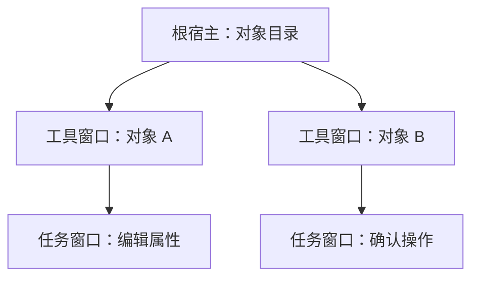

# 空间菜单窗口管理

前台菜单宿主及其窗口由同一共享运行时管理，音乐、家园、地段及通用表单已接入。窗口能力与背景绘制分别维护，主菜单、公告和音乐等页面保留自身的多面板布局。固定世界面板沿用世界宿主的放置与关闭生命周期。API 示例见[空间菜单 API](spatial-menu-api.md#独立窗口)，布局与世界呈现见[菜单架构](spatial-menu-design.md)。

## 模型与职责

一个前台工作区包含根菜单宿主和拥有独立实例身份的子窗口。窗口有自己的内容、局部页面、位置与资源；上层 UI 决定打开窗口还是在原窗口内导航。根宿主的原有组件树作为逻辑空间组参与管理，可包含多个朝向不同的阅读面；它保留自己的导航和关闭入口，共享层补充紧凑的最小化、移动按钮，不生成包住整页的底板或通用标题栏。

窗口身份不由 `UiSurface` 或背景矩形建立。所有权、焦点、模态、最小化和位姿属于实例；面板、背景与标题属于呈现。移动捕获逻辑组的空间基准，纯控件页面也能移动，不依赖某块面板的存在或朝向。显式 `openWindow` 的独立内容才采用宿主提供的不透明阅读底板和标题工具条。

所有权、显示顺序与焦点分别维护：所有权决定关闭及结果接收范围，顺序决定实际前后深度，焦点决定文本输入与系统返回的归属。刷新和异步完成不取得焦点。

| 层次 | 共享机制 | 功能自己的职责 |
| --- | --- | --- |
| 窗口 | 实例、所有者、去重键、模态、存续范围、关闭计划 | 对象身份、任务步骤、未保存修改的判断 |
| 输入 | 单个输入租约、字段身份、验证与响应失效 | 字段含义、聊天或 Dialog 的选择、何时开始编辑 |
| 呈现 | 独立测量、联合空间检查、前景选取、总实体预算 | 内容、有限视口与摆放意图 |
| 生命周期 | 资源清理、作用域检查、一次结果交付 | 数据事务、权限、版本冲突与业务撤销 |

运行时不解析去重键、标题或字段名猜测业务。新功能只组合声明、组件和回调，不增加共享层的功能分支。

## 身份与策略

`MenuWindowSpec` 由 UI 提供。去重键限定在所有者窗口内；对象工具使用业务稳定 ID，独立任务使用自己的任务键。同一键再次打开时激活已有实例，不重新运行内容工厂，不覆盖草稿。不同结果类型不能复用同一键。

| 策略 | 值 | 行为 |
| --- | --- | --- |
| 模态 | `NONE` | 独立工具，不阻挡其他窗口 |
| 模态 | `OWNER` | 阻挡所有者分支，其他对象工具仍可操作 |
| 模态 | `WORKSPACE` | 阻挡整个工作区，只有该任务及其后代可操作 |
| 存续 | `OWNER` | 随所有者关闭；所有者局部换页时保留 |
| 存续 | `PAGE` | 原页面离开时关闭 |
| 位置 | `CENTER`、`LEFT`、`RIGHT`、`BOTTOM_LEFT` | 在工作区有界阅读面内选择位置 |

`tool(key)` 预设为可最小化的非模态右侧窗口；`task(key)` 预设为居中的所有者模态窗口。模态窗口不能单独最小化。工具有模态后代时，也不能最小化整个分支。

每个句柄只操作自己的实例。关闭后同键重开获得新 UUID，旧句柄、重绘、输入和结果无法作用于新实例。`current()` 捕获当前局部页面，供业务回调检查。异步操作仍须自行核对权限、对象版本和请求代次。

## 内容、布局与空间

子窗口通过 `MenuPanel.render/attach/close` 提供内容和资源；`MenuWindowContext` 在内容构造前提供精确句柄及重绘回调。刷新声明、生命周期与页面级快捷动作按各窗口处理。独立窗口的标题、返回、最小化、移动和关闭由共享窗口工具条提供，正文不再重复关闭入口；功能可增加 `headerActions()`。根页面保留原生导航与关闭，共享管理按钮不重复这些动作。

窗口标题使用 `MenuScene.title()` 的显式元数据。根页面的 `withoutTitle()` 隐藏页面标题，元数据仍供最小化卡片使用；可见标题也放在所属空间组内，随内容一起移动。运行时不从正文或侧栏的小标题推断窗口名称，也不使用“窗口列表”补齐缺失标题；未命名的独立窗口只显示工具，恢复卡片使用恢复动作名称。

窗口内容使用 `UiNode`，支持文字、图标、图片、表单、范围、列表及其空间组件。独立原始装饰、装饰帧观察和环绕摄像机的场景需要根场景，不允许作为窗口内容被静默丢弃；附着菜单通过该窗口句柄打开。观看基准、移动策略、主题与全场景动画由工作区根场景统一决定。

每个窗口在自己的视口和宿主有限空间内独立测量，子窗口不扣除父页面的分页高度。独立窗口的标题、工具条与正文共用不透明阅读底板，颜色沿用玩家主题，避免后方文字与世界背景干扰。渲染合成只发生在共享运行时，业务场景不保存窗口树。不同窗口的节点路径按实例和局部页面隔离。

所有阅读面进入同一份已发布几何，显示、命中、世界避障和资源预检使用它。窗口顺序映射为实际前景深度；整组沿用现有空间缩放与避障。窗口被关闭或空间不可验证时立即撤销动作，绘制副本不拥有业务生命周期。

打开或更新失败保留原来的有效界面；新窗口内容清理一次。局部导航先完成布局预检，再结束旧页面资源。布局与内容工厂不做 I/O，不写业务状态。

## 焦点、模态与输入

悬停只更新指向反馈。点击先选取最近的已发布窗口平面，再在该窗口内部选择控件；透明、空白和禁用区域均保护后方。滚轮仅查询指向窗口的范围和分页，不能滚动后方列表。

激活工具窗口会恢复其有效模态后代。窗口列表遵守相同模态规则，不能绕过屏障。关闭后台窗口不改变正在操作的另一窗口的焦点。

每位玩家只有一个文本输入租约。UI 声明 `Field.inputMethod(CHAT | DIALOG)`，默认普通字段为聊天输入；`multiline` 仅声明文本格式。打开表单和 `focus(field)` 只定位；点击文本框或 UI 显式调用 `edit(field)` 才开始捕获。聊天只消费一条消息，之后恢复普通聊天。切换焦点、离开页面或关闭所有者时，旧租约和待交付消息失效。

系统返回依次结束输入、关闭附着菜单、返回焦点窗口内的上一页、请求关闭该窗口，最后返回根导航或关闭工作区。精确的 `close()` 请求关闭对应实例，不依赖当前焦点。

附着菜单保持一个活跃实例，用于按钮附近的短选项和详情。其来源路径包含所属窗口；来源消失或切换窗口时关闭。从短选项进入长表单时开独立任务窗口。点击或滚动菜单外部只关闭并消费本次输入，不将同批数据包传给后方。

## 关闭计划与任务结果

`onCloseRequested` 接收一次可延期的关闭请求，UI 按自己的草稿条件调用 `approve()` 或 `cancel()`。运行时先按后代到所有者处理整个计划，全部批准后才移除原窗口；取消保留原树。检查期间原目标分支不能继续执行冲突动作。

需要交互确认时，正在接受关闭检查的窗口可以打开一个临时审核子窗口；它可位于保留的模态子任务前。取消审核同时撤销本次关闭计划，原任务仍然保留。重复关闭请求不会重复生成检查。离线、换世界和停用强制清理，不等待交互或自动提交草稿。

移除窗口时先从实例索引撤销整个目标子树，再运行清理与回调，避免回调从已关闭父窗口创建孤立任务。单项释放失败不阻止其余窗口、页面和租约清理。面板与场景生命周期各自只结束一次。

`openWindow(spec, Result.class, factory, callback)` 提供类型化结果。`complete(value)` 显式完成任务，普通关闭交付带原因的取消；调用者窗口和原页面仍有效时才交付一次。调用者关闭后，迟到的业务完成不能重开界面。

## 表单与异步保存

`MenuInputForm` 默认将短表单字段同时展示，长表单可由 UI 显式选择 `FIELD_DIRECTORY`。输入方式和布局分别声明，不按字段数量、名称或长度推断。

同步提交成功后关闭；抛出异常保留表单并说明失败。`submitAsync` 在等待期间禁用重复编辑和提交，由功能调用 `Completion.success/failure`。失败保留已接受草稿，允许原窗口重试；迟到或重复完成不会关闭新实例或覆盖下一次提交。

业务事务与窗口可见性分别管理。关闭或失焦不会自动撤销已提交的数据库操作；完成更新业务快照后，功能再按原实例和代次决定是否更新 UI。窗口管理器不合并草稿、不代替版本校验。

## 临时让出世界交互

`handle.suspend()` 或 `context.suspend()` 返回绑定窗口及局部页面的租约。工作区隐藏并让出世界操作，原页面和草稿继续存在。完成世界选取后 `complete()` 恢复同一工作区；失败、取消和超时调用 `close()`。所有者关闭或页面失效也会自动释放。

租约失效后 `complete()` 返回 false，不能恢复被替换的旧工作区。音乐成员选择与载具展示选择共用此机制，业务各自决定选择规则、提示与超时。

## 窗口操作与运行时上限

根场景通过 `MenuScene.windowPolicy(...)` 声明能力，子窗口通过 `MenuWindowSpec.policy(...)` 声明同一种 `MenuWindowPolicy`。默认 `STANDARD` 可最小化与移动；`TASK` 禁止最小化，`FIXED` 关闭这两项能力。模态任务和带模态后代的分支不能最小化。音游与驾驶捕获界面显式使用 `TASK`。能力限制同时作用于工具条与句柄调用。

点击「移动窗口」捕获窗口相对当前眼睛的位置与角度；随后转头，窗口随视野移动。左击任意位置固定，右击恢复移动前的位置，均不要求重新命中移动按钮；受保护方块或实体的取消事件不阻止这两种窗口操作，原世界交互继续被取消。移动期间停止悬浮提示和控件指向、消费其他窗口动作、暂停业务刷新并复用已测量页面，只重新投影空间变换；放置、取消、内容替换及关闭都结束移动状态。正文、底板、图标、范围和命中区域使用同一份几何。根窗口的局部原始装饰随根空间组一起移动，世界名牌和描边保持世界锚点。

最小化后在阅读区下方保留紧凑托盘卡片，不缩小正文为不可读缩略图。卡片保留标题，区分焦点与最小化状态；溢出时横向分页。可见根页面不占托盘卡片，根最小化时才出现恢复入口。点击恢复原实例、页面、草稿和位置。最小化根窗口会一起收起所属工具，根卡片恢复此前焦点；非模态工具也可单独收起。关闭卡片仍经过原关闭计划，不自动提交草稿。托盘不扣除各窗口的独立测量预算。

交互参考 Meta 的[统一窗口操作](https://developers.meta.com/vr/design/windows_implementation/)与[主窗口及辅助窗口布局](https://developers.meta.com/vr/design/multi-window-layouts/)；两次点击移动和托盘卡片是对 Minecraft 输入方式的适配。

统一限制如下，功能没有单独豁免：

- 一个工作区最多保留 8 个实例，包含根菜单宿主；所有权深度也受此上限限制。
- 最多同时绘制 3 个完整阅读面，包含根、焦点窗口及其直接所有者；剩余名额给最近使用的根工具。其余内容保留，通过下方托盘恢复，与用户最小化状态分别维护。
- 屏外和最小化窗口暂停状态刷新及呈现采样，恢复后从业务快照重绘。
- 所有窗口、附着菜单、提示、点击辅助和退出副本共享每位玩家 2048 个虚拟实体预算。容量或布局预检失败拒绝本次打开，保留既有草稿。

当前更新合并在同一工作区呈现流程，使用同一次几何和空间准备；未提供跨 tick 的测量任务调度器。任意尺寸调整、跨工作区转移与专用开发诊断界面属于后续扩展，不包含在当前操作中。

## 实现位置

| 类型 | 职责 |
| --- | --- |
| [MenuWindowPolicy](../src/main/java/org/encinet/mik/shared/menu/MenuWindowPolicy.java) | 根窗口与子窗口共用的能力和关闭策略 |
| [MenuWindowSpec](../src/main/java/org/encinet/mik/shared/menu/MenuWindowSpec.java) | UI 的窗口策略 |
| [MenuWindowContext](../src/main/java/org/encinet/mik/shared/menu/MenuWindowContext.java)、[MenuWindowHandle](../src/main/java/org/encinet/mik/shared/menu/MenuWindowHandle.java) | 精确实例及类型化完成 |
| [MenuWorkspaceSession](../src/main/java/org/encinet/mik/shared/menu/runtime/MenuWorkspaceSession.java) | 所有权、顺序、焦点、局部页面、关闭计划与租约 |
| [MenuWindowPresentation](../src/main/java/org/encinet/mik/shared/menu/runtime/MenuWindowPresentation.java) | 分别呈现原生页面与独立窗口，管理能力不要求外层底板 |
| [MenuWindowLayout](../src/main/java/org/encinet/mik/shared/menu/runtime/MenuWindowLayout.java) | 独立有限视口与摆放 |
| [MenuWindowInput](../src/main/java/org/encinet/mik/shared/menu/runtime/MenuWindowInput.java) | 已发布平面的前景选取 |
| [MenuFormPanel](../src/main/java/org/encinet/mik/shared/menu/MenuFormPanel.java)、[MenuInputEditor](../src/main/java/org/encinet/mik/shared/menu/runtime/MenuInputEditor.java) | 复用文本框、草稿和保存过程 |
| [FloatingMenuService](../src/main/java/org/encinet/mik/shared/menu/runtime/FloatingMenuService.java) | 主线程装配、网络呈现、输入路由与玩家生命周期 |

## 迁移与验证

音乐设备工具固定绑定各自设备，重复打开激活原实例；激活不改变全局播放目标。歌单创建、设置、复制、保存目的地、设备改名、精确音量、同步组及删除确认使用独立任务窗口。已删除音乐自己的任务返回栈和表单面板。

家园确认使用同一窗口入口。地段表单接入异步完成，错误留在原表单；通用 `FloatingMenus.input` 使载具、治理等已有字段入口自动获得独立窗口。普通分类导航仍在原页面，不为每次切换分类新建窗口。

行为测试覆盖所有权及模态、唯一键、失效句柄、类型化结果、关闭检查及取消、清理重入、数量和布局失败、局部页面存续、最小化、实地选取租约、前景空白保护、异步草稿重试与音乐多设备流程。翻译、字号和页面几何复用公共测试设施。服务端构建不能替代游戏内的深度、焦点辨识与文字可读性验收。
