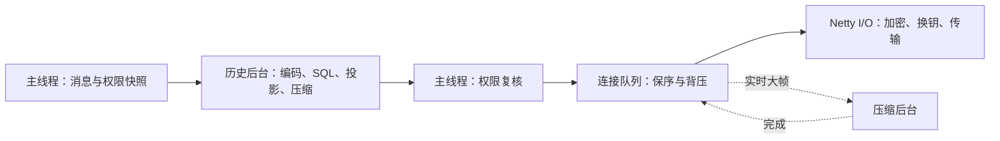

# 网页聊天

登录后打开官网导航的「网页聊天」或 `https://mcmik.top/chat` 即自动连接，离开页面时断开。公共、管理和私聊与游戏互通；网页从在线名单发起私聊，游戏使用 `/msg`、`/r`。

## 接入配置

`wss://chat.mcmik.top/ws` 通过 Cloudflare Tunnel 转发到插件的 `127.0.0.1:35354`。在现有 Tunnel 中增加路由，并配置对应的 DNS：

```yaml
ingress:
  - hostname: chat.mcmik.top
    path: ^/ws$
    service: http://127.0.0.1:35354
  - hostname: chat.mcmik.top
    service: http_status:404
  # 其余现有路由
  - service: http_status:404
```

插件只接受 Origin `https://mcmik.top` 和 `X-Forwarded-Proto: https`。聊天端口与私有账号 API 端口 `35353` 分开，均只监听本机回环地址。

首次启动生成 `plugins/mik/web-chat.key`（权限 `0600`），日志输出 `Web chat public key`。将公钥配置为网页的 `NEXT_PUBLIC_WEB_CHAT_PUBLIC_KEY` 后部署网页。重启沿用原密钥；更换私钥时同步更新网页公钥。私钥随插件数据备份。

`plugins/mik/config.yml`：

```yaml
web-chat:
  port: 35354
  max-connections: 32
  max-connections-per-player: 8
```

达到上限时拒绝新连接。

## 权限与在线状态

- 封禁账号无法登录；管理频道仅限管理与维护者。私聊仅双方可见，发送时接收方须在游戏或网页在线。
- 网页与游戏共用玩家可见性和按 UUID 计算的发言额度：突发 3 条，每 2 秒恢复一条，重连保留额度。
- 游戏消息仅在频道接收范围完整时跨端转发；其他插件缩小接收范围的消息留在游戏内。
- 同一玩家的多个网页连接在 Tablist 合并为一个条目，显示原账号名牌与皮肤、`[网页]` 或 `[网页 ×3]` 来源标签。网页条目与游戏条目分开，不计入游戏在线人数和原版命令补全。
- 首个网页连接完成授权和密钥确认后发布加入事件，最后一个断开时发布退出事件。游戏加入退出由游戏事件发布。

## 消息与通知

网页支持单行文字、链接和 `@玩家名`，输入 `@` 可补全当前频道的在线玩家。每条最多 256 个 Unicode 字符；MiniMessage、物品读取与 `@all` 仅供具备相应能力的来源使用。

各来源共用 `ChatContent`、`ChatStyle` 和投递流程。插件解析富文本后，网页接收结构化的颜色、渐变、装饰、链接与提及；实时消息和缓存共用字段校验，文字由 React 转义，链接限 HTTP(S) 和单个邮箱地址。超出格式预算时退为保留完整正文的纯文本。

公共消息写入控制台，并按配置同步 QQ、Matrix；管理和私聊只投递给频道成员。Social 公开消息可直接显示在网页，作者可为未绑定用户或游戏离线玩家。网页协议以 `kind: user` 保存稳定作者标识、显示名、可选 Minecraft 绑定及来源；外部消息 ID 包含会话作用域。未绑定作者使用通用头像，提及和私聊操作依据实际玩家绑定。

游戏聊天按「频道 → 来源 → 完整名牌 → 正文」显示，公共频道省略频道标记；Tablist 的来源标签位于完整名牌之后。标签按接收者语言显示，QQ、Matrix 保留平台名，`[基岩]` 由 Geyser 的实际游戏连接确定。

服务器事件与玩家发言共用时间线、顺序信息、历史、搜索和跳转。加入退出保持静默，公告更新可计入未读。私聊和提及通知在聊天设置开启，需要浏览器授权；同一浏览器的标签页合并提醒，不同设备分别提醒，仅在线连接提供通知。

断线后自动重新授权、建立密钥并补齐历史，未确认的发言由用户决定是否重发。页面恢复可见或网络恢复时立即检查连接。

## 服务端历史

公共、管理和私聊保存到 `plugins/mik/chat-history.db`，按录入时间保留 **7 天**，独立于网页连接。启动及每小时清理过期记录，查询实时排除到期数据；删除空间由 SQLite 后续写入复用。

数据库使用 SQLite WAL，以消息 ID 去重，按频道、私聊双方、时间和递增游标索引。JSON 快照保存富文本、作者、来源、提及和服务器模板；物品只保留展示文字。占位内容读取时按查看者语言显示。

公共历史对已授权账号开放，管理历史检查当前权限，私聊仅参与双方可读，支持查询离线对象。受限服务器事件保存发布时允许查看的账号集合，并在读取时检查当前可见性；普通公开事件按频道开放。响应发送前复核连接、授权和可见范围，变化时返回 `history_unavailable` 重试。

发送回执确认聊天流程已接收，历史在后台另行写入。写入失败记录日志，实时投递继续；故障或异常退出可能丢失尚未保存的历史。

数据库包含私聊明文，POSIX 文件系统上首次创建权限为 `0600`。运行中使用 SQLite 一致性备份，或停服后复制；备份期限单独管理。

### 分页协议

查询复用已授权的加密 WebSocket，请求是最多六个字段的平面字符串对象：

```json
{"type":"history","requestId":"0123456789abcdef","channel":"public"}
```

| 字段 | 含义 |
| --- | --- |
| `type`、`requestId` | 类型固定为 `history`，请求标识关联本次响应 |
| `channel` | `public`、`staff` 或 `private` |
| `targetUuid` | 可选，限定私聊对象；省略时查询自己的全部私聊 |
| `before` | 可选，使用上一页的 `nextBefore` 继续向前翻页 |
| `after` | 可选，只查询已完成同步位置之后的记录，默认 `0` |

每页最多 256 条，本地化后的消息数组最多 120 KiB，完整响应原文最多 128 KiB。超大富文本降低样式复杂度并保留正文；未装入的消息留到下一页。单连接每次一个查询，服务端间隔至少 200 毫秒，前端按 250 毫秒串行推进。

响应包含 `type: history`、原 `requestId`、`channel`，以及：

| 字段 | 含义 |
| --- | --- |
| `messages` | 本页消息，按录入顺序从旧到新；复用实时结构、原 `streamId` 和 `sequence`，移除发送回执 `requestId` |
| `hasMore`、`nextBefore` | 是否继续、下一页字符串游标；过滤后的空页也按这两项推进 |
| `head` | 本轮数据库位置 |
| `databaseId`、`visibilityScope` | 数据库身份与查看范围，用于校验续传位置 |
| 消息的 `expiresAt` | 服务端可补同步的截止时间，本机保留期限独立管理 |

SQLite 游标表示录入顺序，消息时间用于展示，`streamId`、`sequence` 用于实时顺序和阅读位置。分页只使用数据库游标。

### 完整同步

网页采用 [Matrix 的游标同步与缺口补齐](https://spec.matrix.org/v1.17/client-server-api/#syncing)方式，首次拉取全部可访问的 7 天公共、管理和私聊记录；之后每 30 秒及重新授权、重连时补增量。

一轮固定第一页的 `head`，用 `before` 向前补齐到上一轮的 `after`。每页消息和续传位置在同一 IndexedDB 事务中提交，整轮完成后将 `after` 推进到固定 `head`。新消息留到下一轮，中断从已提交页继续；多标签页比较原位置后更新。缓存清理使代次失效时重新获取代次与存储偏好，游标冲突时接续另一标签页的进度。

数据库替换、回退或可见范围变化时重新补齐。管理权限新增时补管理历史，撤销时清理对应缓存和位置。历史与实时消息按 ID 合并，保留实时未读状态，补历史保持静默。列表分段显示，搜索覆盖已同步记录，失败可重试。

数据库不可用或队列满返回 `history_unavailable`，查询限流返回 `rate_limited`。历史查询独立于发言额度和网页登录闲置计时。

### 通用传输与历史压缩

数据经过「JSON → UTF-8 → 按收益压缩 → HPKE 认证加密 → WebSocket 二进制帧」。浏览器支持 `DecompressionStream('deflate')` 时，在加密的 `finished` 确认中声明 `compression: "deflate"`；能力固定至连接结束。不支持时发送普通加密数据，WebSocket 扩展关闭。

| 内容 | 压缩方式 |
| --- | --- |
| 下行消息、在线名单、历史页 | 原文至少 1 KiB，含长度头后节省至少 128 字节且达到 10% 时压缩 |
| 历史页字典 | 每帧新建 zlib 流；相邻同频道、同私聊双方的普通消息共享字典，元数据和显式受限记录各自隔离，组间用 `FULL_FLUSH` 重置字典 |
| 上行请求、授权、回执、错误、换钥 | 不压缩；上行应用请求最多 8 KiB |
| WebSocket 心跳 | 使用原生控制帧，直接通过 |

分页数量与字节预算按原文计算。字典隔离依据见 [RFC 7692 安全说明](https://www.rfc-editor.org/rfc/rfc7692.html#section-8)。

加密记录类型 `0` 为普通数据，`1` 为换钥，`2` 为压缩数据。类型 `2` 的载荷是 4 字节大端原始 UTF-8 长度和完整 zlib 流，类型与载荷一起认证加密。前端认证解密后分块解压，校验 128 KiB 上限、精确长度、UTF-8 和消息结构；校验和错误、截断、尾随数据及类型错误均关闭连接。zlib 格式见 [Compression Standard](https://compression.spec.whatwg.org/#supported-formats)。

`./gradlew benchmark --tests '*WebChatTransferBenchmarkTest'` 测量合成 100 条历史、7 天／7000 条混合消息和实时消息的本地编码成本与压缩率，浏览器互通样本输出到 `build/reports/benchmarks/chat-history-wire.js`。

### 线程与队列



`ChatHistoryStore` 用单个有界队列维护存储顺序，`WebChatHistory` 编解码不可变快照，`WebChatModule` 维护连接与 Bukkit 状态。后台使用主线程捕获的权限和语言上下文。

`WebChatSocketServer` 管理 I/O 和两个实时压缩线程，每线程最多 256 个待执行任务；`WebChatPacketEncoder` 限制每连接 16 条、256 KiB 待发数据并按序交给 `WebChatCipher`。心跳直接通过，写入失败或拥塞时关闭连接。关闭时取消压缩、解压和换钥任务，释放排队数据；历史队列最多等待 5 秒排空。

## 本机缓存

开启本机保存后长期保留同步结果，服务端 7 天到期后仍可在此浏览器读取和搜索。离开聊天保留缓存与续传位置，退出登录或切换账号清空。写入失败时提示并继续内存同步，下次从最后提交的位置补齐。

聊天设置的「管理本机记录」显示消息数量与最早日期，支持按全部、公共、管理、全部私聊及 30／90／365 天以前或全部时间清理。确认框固定展示待清理的类型、条数和截止时间。

| 操作 | 清理范围 | 保留内容 |
| --- | --- | --- |
| 清理消息 | 选定类型和时间内的消息 | 草稿、会话、阅读状态、偏好、续传位置 |
| 清空全部记录 | 全部消息、草稿、会话和阅读状态 | 偏好、保存开关 |
| 关闭并清空 | 全部本机聊天数据，关闭保存 | 偏好；当前页面继续内存同步 |

删除与清理截止时间在同一事务提交，消息代次更新后拒绝旧标签页及在途同步写回已清理记录。分类清理保留工作区代次，草稿可继续保存；全部清空同时更新两种代次。其他标签页重新加载剩余缓存。

本机清理范围独立于服务端历史。超过服务端期限的本机记录删除后无法补回；浏览器清除网站数据或回收空间也会移除记录，详见 [MDN 存储配额说明](https://developer.mozilla.org/en-US/docs/Web/API/Storage_API/Storage_quotas_and_eviction_criteria)。

## 授权与加密

网页通过同源 `POST /api/account/chat/authorize` 请求授权，MikData 验证会话后经私有 VPC 授权插件，复用 `MIKWEB_AUTH_CLIENT_SECRET`。授权最长 60 秒，同一登录会话每 45 秒合并续验，闲置期限保持原计时。退出或撤销会话时关闭连接，撤销通知失败则随现有授权到期失效。

浏览器与插件使用 RFC 9180 HPKE（P-256、HKDF-SHA256、AES-256-GCM）的双向独立上下文。长期密钥签名认证临时公钥，授权将临时公钥绑定到连接，浏览器通过 Finished 证明持有私钥后激活身份。协议标识为 `mik-chat-hpke-2026-11-08`，两端配套更新。

每 30 分钟或任一方向处理 16,384 条记录后，在原连接内换钥。交换期间有界缓存，5 秒超时、篡改、重放或乱序时关闭；结束后释放旧密钥上下文并清零受控明文缓冲区。

Cloudflare 转发聊天密文，可见连接元数据；网页脚本、登录服务、浏览器和插件主机属于可信端点。数据库与本机缓存以明文保存。

聊天消息和在线名单直接经过 Tunnel；授权续验使用 Workers/DO。32 个不同登录会话持续在线约产生 61,440 次授权请求／天。
